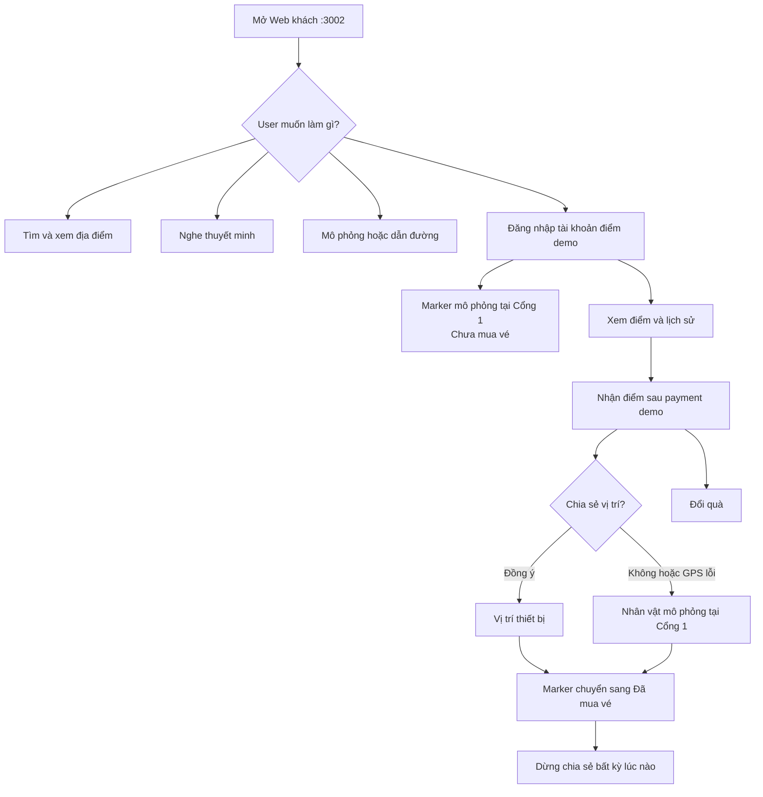

# Hướng dẫn luồng User — Web khách tham quan

Tài liệu này dành cho người dùng cuối trên **Web khách tham quan** tại
http://localhost:3002. User có thể dùng bản đồ mà không cần tài khoản; chỉ cần
đăng nhập demo khi muốn nhận điểm, đổi quà hoặc xuất hiện trên bản đồ vận hành.

> Chỉ dùng số điện thoại thử nghiệm. Demo không gửi OTP, không thu tiền thật và
> không được dùng để dẫn đường ngoài thực địa.

## 1. Tổng quan luồng User

## 2. Mở ứng dụng và khám phá không cần đăng nhập

1. Mở http://localhost:3002.
2. Chọn `VI` hoặc `EN` ở góc trên bên phải để đổi ngôn ngữ giao diện.
3. Dùng ô **Tìm trò chơi, khu tham quan…** để nhập:
   - Tên địa điểm, ví dụ `Vườn Cầu Vồng`.
   - Tên không dấu, ví dụ `vuon cau vong`.
   - Nhu cầu, ví dụ `tôi muốn xem biểu diễn âm nhạc`.
   - Hướng, ví dụ `xa nhất về phía đông`.
4. Chọn một kết quả hoặc marker trên bản đồ để mở thẻ chi tiết.
5. Xem mô tả, khu vực con, ghi chú dịch vụ và thông tin thuyết minh.

Nếu bảng bên trái đang thu gọn, bấm nút mở bảng để thấy tìm kiếm và danh sách
địa điểm. Trên điện thoại, bảng địa điểm nằm bên dưới bản đồ.

## 3. Nghe thuyết minh

### Nghe thủ công

1. Mở thẻ chi tiết của một địa điểm.
2. Chọn ngôn ngữ thuyết minh `VI` hoặc `EN`.
3. Bấm **Nghe thuyết minh**.
4. Dùng nút tạm dừng/tiếp tục hoặc phát lại khi cần.

Nếu địa điểm chưa có audio đã duyệt, ứng dụng có thể đọc nội dung bằng giọng
trình duyệt. Nếu ngôn ngữ được chọn chưa có nội dung, giao diện báo rõ bản
fallback đang sử dụng.

### Tự động thuyết minh

1. Trong bảng bên trái, tìm mục **Tự động thuyết minh**.
2. Bấm **Bật tự động**.
3. Cấp quyền vị trí hoặc dùng **Người mô phỏng**.
4. Khi user/người mô phỏng đến trong khoảng 50 m, ứng dụng tự phát bài của địa
   điểm gần nhất và hiển thị tối đa hai địa điểm đang ở gần.
5. Bấm **Tắt tự động** để dừng.

## 4. Dùng Người mô phỏng

Đây là cách dễ nhất để trình bày luồng User mà không cần GPS thật.

1. Bấm **Người mô phỏng** trên thanh công cụ.
2. Bấm **Đặt người trên bản đồ**.
3. Click vào một lối đi; nhân vật sẽ tự bám vào walkway gần nhất.
4. Chọn một địa điểm trên bản đồ hoặc danh sách.
5. Trong thẻ địa điểm, bấm **Dẫn đường từ người mô phỏng**.
6. Bấm **Bắt đầu đi** để nhân vật đi tự động theo tuyến màu vàng.
7. Có thể dùng nút điều khiển, phím mũi tên, `WASD` hoặc gamepad để di chuyển
   thủ công.
8. Khi đến gần POI, tự động thuyết minh sẽ phát nếu đang bật.

Các thao tác bổ sung:

- **Đặt lại vị trí**: chọn một điểm bắt đầu khác.
- **Đi lại tuyến**: phát lại tuyến hiện tại.
- **Xóa mô phỏng**: xóa nhân vật và trạng thái mô phỏng.

## 5. Dẫn đường từ vị trí thật

1. Chọn một địa điểm.
2. Bấm **Dẫn đường từ vị trí của tôi**.
3. Cho phép trình duyệt dùng vị trí.
4. Đi theo tuyến màu vàng và thông tin khoảng cách còn lại.

Nếu GPS bị từ chối, tín hiệu yếu hoặc trình duyệt không hỗ trợ GPS, dùng
**Người mô phỏng**. Trên điện thoại, trình duyệt thường yêu cầu HTTPS mới cấp
GPS; localhost trên máy demo là ngoại lệ tùy trình duyệt.

## 6. Đăng nhập tài khoản điểm demo

1. Bấm **Đăng nhập** ở góc trên bên phải.
2. Màn hình **Vào bằng số điện thoại** xuất hiện.
3. Nhập một số thử nghiệm, ví dụ `0901234567`.
4. Bấm **Mở tài khoản demo**.
5. Sau khi đăng nhập, nút góc phải đổi thành số đã che kèm chữ **Điểm**.
6. Hệ thống tự tạo một marker ẩn danh mô phỏng gần Cổng 1. Dashboard vận hành
   ghi **Chưa mua vé** cho tới khi tài khoản có payment thành công. Marker này
   không dùng GPS thật.

Demo không gửi và không xác minh OTP. Cùng một số đã chuẩn hóa sẽ mở lại cùng
tài khoản điểm local.

## 7. Nhận điểm sau thanh toán demo

Luồng User cần phối hợp với màn hình quầy tại http://localhost:3003:

1. User đã đăng nhập visitor bằng số thử nghiệm.
2. Nhân viên quầy nhập cùng số trên payment web, chọn vé và tạo QR.
3. User mở link QR và bấm **Thanh toán demo**.
4. Chờ khoảng hai giây để trạng thái chuyển sang `succeeded`.
5. Trở lại visitor và bấm nút tài khoản **… · Điểm**.
6. Balance tự cập nhật và hiển thị thông báo
   **Thanh toán demo thành công · +… điểm**.
7. Visitor đồng thời hiện hộp **Bạn muốn xuất hiện ở đâu?**:
   - Chọn **Chia sẻ vị trí của tôi** để dùng vị trí thiết bị.
   - Chọn **Dùng nhân vật mô phỏng tại Cổng 1** nếu không muốn gửi GPS.
   - Nếu quyền GPS bị từ chối, lỗi hoặc vị trí ngoài phạm vi demo, ứng dụng tự
     chuyển sang nhân vật mô phỏng tại Cổng 1.

Nếu realtime tạm ngắt, visitor vẫn tự kiểm tra lại balance khoảng hai giây một
lần. User không cần bấm thanh toán lại.

Nếu user đã thanh toán trong ngày, đóng app rồi mở lại và đăng nhập cùng tài
khoản, ứng dụng sẽ hỏi lại **Bạn muốn xuất hiện ở đâu?** một lần cho lượt mở
trang mới. Trước khi user chọn, hệ thống đã đặt một marker mô phỏng tại Cổng 1;
vì vậy từ chối GPS hoặc chưa trả lời cũng không làm user biến mất khỏi bản đồ
vận hành. Vé của ngày trước không được tính là vé hôm nay.

## 8. Xem điểm, lịch sử và đổi quà

1. Bấm nút **… · Điểm** ở góc trên bên phải.
2. Xem:
   - Tổng **điểm hiện có**.
   - Danh sách quà và số điểm cần đổi.
   - **Lịch sử gần đây** gồm điểm cộng/trừ.
3. Khi đủ điểm, bấm **Đổi quà**.
4. Sau khi thành công, lưu mã nhận quà hiển thị trên màn hình.
5. Balance và lịch sử được cập nhật ngay.

Nút **Đổi quà** bị khóa nếu user chưa đủ điểm hoặc một yêu cầu đổi quà khác
đang xử lý. Bấm **Đăng xuất tài khoản** khi muốn kết thúc phiên.

## 9. Hiển thị trên bản đồ vận hành và thấy khách khác

Ngay sau khi đăng nhập tài khoản demo, user xuất hiện bằng marker ẩn danh mô
phỏng tại Cổng 1. Vận hành thấy pseudonym, màu riêng và trạng thái **Đã mua
vé** hoặc **Chưa mua vé**, nhưng không thấy số điện thoại hay user ID.

Sau payment thành công, ứng dụng tự mở lựa chọn vị trí. User cũng có thể bật
thủ công bằng nút **○ Chia sẻ vị trí với vận hành**.

1. Trước payment, nút hiển thị dạng **● Ẩn danh A1B2 · mô phỏng khi đăng
   nhập**; vị trí này không phải GPS thật.
2. Sau payment, chọn **Chia sẻ vị trí của tôi** và cấp quyền GPS; hoặc chọn **Dùng nhân vật
   mô phỏng tại Cổng 1**.
3. Khi dùng GPS, nút đổi thành **● Đang chia sẻ vị trí demo**.
4. Khi dùng fallback, nút hiển thị dạng
   **● Ẩn danh A1B2 · mô phỏng Cổng 1**.
5. Mỗi user mô phỏng có biệt danh, màu và vị trí lệch nhẹ riêng quanh Cổng 1,
   nên nhiều user không bị chồng thành một người trên admin live map.
6. Vận hành chỉ thấy pseudonym/avatar, trạng thái vé và latest point còn hiệu
   lực; bấm marker để xem biệt danh và trạng thái vé.
7. Bấm lại nút để dừng hiển thị.

Trên chính bản đồ visitor, mỗi tài khoản đã đăng nhập còn thấy các khách đang
hoạt động khác. Góc dưới bản đồ hiển thị **… khách khác trên bản đồ**. Marker
của chính user bị lọc để không vẽ trùng với marker vị trí của mình. Nếu nhiều
marker ở gần nhau, bản đồ tự gom thành cụm; phóng to để tách từng người.

Khách khác chỉ nhận biệt danh ẩn danh, biến thể màu, loại vị trí
**mô phỏng/vị trí ẩn danh** và latest point. Họ không nhận số điện thoại, user
ID, trạng thái mua vé hoặc điểm đến. GPS thật được dịch cố định khoảng 15 m
trước khi gửi cho các visitor khác; admin vẫn dùng latest point chính xác cho
vận hành. Marker mô phỏng giữ offset riêng quanh Cổng 1, nên hai hay nhiều user
có biệt danh, màu và vị trí dễ phân biệt.

Khi user di chuyển **Người mô phỏng** bằng nút/phím điều hướng hoặc bấm bắt đầu
đi theo tuyến, các visitor khác thấy marker đó dịch chuyển realtime. Client gửi
tối đa một điểm mỗi giây, bỏ qua rung dưới 2 m và luôn gửi điểm cuối sau khoảng
throttle; vì vậy chuyển động mượt nhưng không tạo quá nhiều request. Các update
được gửi tuần tự để tránh lỗi rate-limit khi giữ phím di chuyển.

Cam kết của luồng demo:

- Chỉ marker Cổng 1 mô phỏng được tạo tự động sau đăng nhập; GPS thật luôn cần
  user chủ động opt-in.
- Mỗi lần mở lại app/trang, tài khoản đã thanh toán hôm nay được hỏi lại về GPS;
  không chọn hoặc từ chối sẽ tiếp tục dùng marker Cổng 1 mô phỏng.
- Không lưu lịch sử GPS thô.
- Latest point tự hết hạn sau 45 giây.
- Dừng chia sẻ sẽ xóa point ngay.
- Không gửi vị trí nền khi trang không hoạt động.

## 10. Happy path đề xuất khi trình bày

Thời lượng khoảng 5–7 phút:

1. Mở visitor và tìm một địa điểm bằng câu nhu cầu.
2. Mở chi tiết, đổi ngôn ngữ và nghe thuyết minh.
3. Đặt Người mô phỏng, tạo tuyến và bấm Bắt đầu đi.
4. Đăng nhập bằng số `0901234567`.
5. Trên admin live map, chỉ ra marker mới với trạng thái **Chưa mua vé**.
6. Trên payment web, tạo QR cho cùng số và hoàn tất payment demo.
7. Trở lại visitor, mở Điểm và chỉ ra balance vừa tăng.
8. Trên admin, chỉ ra cùng user đã chuyển sang **Đã mua vé**.
9. Đổi **Nước uống demo** nếu đủ 100 điểm.
10. Trong hộp xuất hiện sau payment, chọn nhân vật mô phỏng tại Cổng 1.
11. Mở visitor ở tab thứ hai, đăng nhập số demo khác và xác nhận mỗi tab hiện
    **1 khách khác trên bản đồ**; đồng thời quan sát hai pseudonym/màu/vị trí
    riêng trên admin live map, rồi tắt chia sẻ.

## 11. Xử lý sự cố dành cho User

| Hiện tượng            | Cách xử lý                                                           |
| --------------------- | -------------------------------------------------------------------- |
| Không thấy địa điểm   | Xóa từ khóa tìm kiếm hoặc tải lại trang                              |
| Không phát được audio | Đổi VI/EN, kiểm tra âm lượng hoặc dùng fallback giọng trình duyệt    |
| Không tạo được tuyến  | Đặt lại Người mô phỏng lên một lối đi rồi thử lại                    |
| Không lấy được GPS    | Cấp quyền vị trí hoặc chuyển sang Người mô phỏng                     |
| Điểm chưa cập nhật    | Chờ 2–3 giây, đóng rồi mở lại hộp Điểm; không thanh toán lại         |
| Không đổi được quà    | Kiểm tra balance có đủ điểm hay không                                |
| Presence báo lỗi      | Kiểm tra đăng nhập; nếu GPS lỗi, chọn mô phỏng tại Cổng 1            |
| Trang không phản hồi  | Tải lại trang; nếu vẫn lỗi, chạy `node scripts/demo/demo.mjs status` |

Luồng dành cho cashier/operations và chi tiết kỹ thuật nằm tại
[`README-LUONG-DEMO.md`](README-LUONG-DEMO.md).
