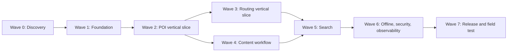

# Agent Execution Plan — Dam Sen Smart Guide

Tài liệu này biến [PROJECT_PLAN.md](../PROJECT_PLAN.md) thành các work package có dependency và checklist. Agent phải tuân theo [AGENTS.md](../AGENTS.md), xem task hiện tại trong [STATUS.md](STATUS.md) và tra [FEATURE_REGISTRY.md](FEATURE_REGISTRY.md) trước khi implementation.

## 1. Nguyên tắc điều phối

### Vai trò

- **Coordinator/Architect**: chia task packet, khóa contract, quản lý dependency và review tích hợp.
- **Foundation/Platform agent**: monorepo, config, shared contract, CI.
- **API agent**: auth, POI, workflow, routing/search endpoint.
- **Mobile agent**: app visitor, map, GPS, audio, navigation, offline.
- **Admin agent**: CMS, map editor, review và audit UI.
- **Geo agent**: dữ liệu bản đồ, walkway graph, topology và routing validation.
- **Search/ML agent**: lexical, embedding, hybrid ranking và evaluation.
- **QA/DevOps agent**: test harness, observability, deploy/staging và field-test protocol.

Một agent có thể giữ nhiều vai trò theo thời điểm, nhưng một task chỉ có một owner. Không giao hai agent sửa cùng module trong cùng wave.

### Trạng thái task

`TODO -> READY -> IN_PROGRESS -> REVIEW -> DONE`, hoặc `BLOCKED`.

- `READY`: dependency hoàn tất và task packet đủ.
- `DONE`: acceptance checklist + verification đều đạt.
- Chỉ coordinator thay đổi dependency/contract xuyên module.

### Cách chạy song song

Mỗi wave có thể chạy song song các task không chung file và không phụ thuộc kết quả chưa ổn định. Sau wave phải có integration gate trước khi mở wave tiếp theo.

## 2. Checklist của coordinator

### Trước mỗi wave

- [ ] Chọn các task có dependency `DONE`.
- [ ] Điền task packet cho từng agent.
- [ ] Chỉ định rõ file/module ownership.
- [ ] Chốt OpenAPI/schema/shared type liên quan.
- [ ] Xác nhận không có hai agent sửa cùng shared file.
- [ ] Gắn link required reading cụ thể, không yêu cầu đọc toàn bộ plan.

### Sau mỗi wave

- [ ] Thu handoff theo format trong `AGENTS.md`.
- [ ] Kiểm tra status trong feature registry.
- [ ] Chạy integration gate.
- [ ] Giải quyết drift giữa OpenAPI, generated client, migration và UI.
- [ ] Ghi ADR nếu quyết định kiến trúc mới phát sinh.
- [ ] Mở task tiếp theo chỉ khi contract upstream ổn định.

## 3. Task graph tổng quát



### T35-OSM — OSM research POIs and walkway overlay

```text
Task ID: T35-OSM
Goal: Replace the visitor demo grid with public-map-referenced Dam Sen POIs and walkways.
In scope: five dev POIs, OSM walkway snapshot, in-memory research routing, visitor overlay and attribution.
Out of scope: claiming official/field-verified navigation, production release, replacing the PostgreSQL routing migration.
Dependencies completed: T21, T33, T35.
Files/modules allowed: apps/api/src/poi, apps/api/src/routing, apps/api/test, apps/visitor-web, docs.
Contracts consumed: existing POI, narration and POST /v1/routes contracts.
Contracts produced: no public schema change; updated local fixture content and research geometry.
Required reading: AGENTS.md, docs/STATUS.md, ADR-0002, VISITOR-WEB/ROUTE-API registry entries.
Acceptance checks: real public references, visible attribution/warning, connected path graph, no unverified accessibility claim.
Verification commands: API typecheck/test; visitor lint/typecheck/test/build.
```

- [x] Reuse MapLibre, POI API, narration and routing contracts.
- [x] Record OSM provenance and retrieval date.
- [x] Keep field-verification warning visible.
- [x] Verify all five destinations share one connected research graph.
- [x] Run scoped quality checks.

### T35-SIM — Browser walking simulation and arrival narration

```text
Task ID: T35-SIM
Goal: Let a learner place a simulated visitor, walk a route in 1–3 metre steps, and hear narration on arrival.
In scope: map placement mode, simulated marker, route progress controls, arrival dialog and browser TTS.
Out of scope: background autoplay, real GPS spoofing, server persistence and authoritative navigation.
Dependencies completed: T24–T25, T33, T35-OSM.
Files/modules allowed: apps/visitor-web/**, docs/FEATURE_REGISTRY.md, docs/STATUS.md.
Contracts consumed: GeoPoint, RouteResponse and PoiNarration.
Contracts produced: reusable route interpolation helper; no API/schema change.
Required reading: AGENTS.md, apps/visitor-web/AGENTS.md, docs/STATUS.md, VISITOR-WEB/NARRATION/ROUTE-API registry entries.
Acceptance checks: click-to-place; route from simulation; exact 1/2/3 m step; marker follows route; arrival dialog; TTS with replay/stop; GPS remains separate.
Verification commands: visitor lint, typecheck, unit tests and production build.
```

- [x] Reuse the existing MapLibre marker, route API and narration transcript.
- [x] Keep simulation state local to the browser.
- [x] Cover distance interpolation and completion with unit tests.
- [x] Handle unsupported Web Speech without breaking arrival UX.
- [x] Run scoped quality checks and update registry/status.

### N07D — Shared visitor presence map

```text
Task ID: N07D
Goal: Let authenticated visitors on localhost:3002 see one another as pseudonymous characters on the same map without exposing payment or identity data.
In scope: visitor-safe snapshot/event contract; authenticated realtime visitor room; explicit peer visibility consent; deterministic GPS blur; MapLibre clustered layer; snapshot reconciliation and batched delta rendering; multi-user browser acceptance.
Out of scope: messaging/social features, public unauthenticated tracking, phone/user ID/ticket-state exposure, background GPS, durable location history, production rollout.
Dependencies completed: N06, N07A–N07C, T35.
Files/modules allowed: packages/shared-types/**, packages/api-client/**, apps/api/openapi.yaml, apps/api/src/operations/**, apps/api/src/realtime/**, apps/api/test/**, apps/visitor-web/**, docs/AGENT_EXECUTION_PLAN.md, docs/FEATURE_REGISTRY.md, docs/STATUS.md, docs/plans/OPERATIONS_LOYALTY_PAYMENT_REALTIME_MAP_CHECKLIST.md, demo/README-LUONG-USER.md.
Contracts consumed: ephemeral presence TTL/store, authenticated realtime gateway, visitor MapLibre instance, consented location mode.
Contracts produced: GET /v1/me/nearby-presence; VisitorPresencePoint/Snapshot; visitor.presence.delta.v1; additive visibleToVisitors/locationMode start fields.
Required reading: AGENTS.md, apps/api and visitor AGENTS.md, docs/STATUS.md, ADR 0016 presence rules, N07A–N07C packets, LIVE-PRESENCE-DEMO and OPERATIONS-REALTIME registry entries.
Acceptance checks: two authenticated visitors see one another; own remote marker is filtered; unauthenticated requests fail; visitor payload has no user ID/phone/ticket/destination; actual GPS is deterministically blurred while admin stays exact; removal/TTL/reconnect converge; deltas render at most once per animation frame; 1,000-point source update remains responsive.
Verification commands: API presence/realtime/privacy tests; visitor helper tests/lint/typecheck/build; API typecheck/test/build; two-browser local acceptance; scoped performance smoke.
```

- [x] Add visitor-safe snapshot and realtime contracts without reusing admin payloads.
- [x] Add authenticated visitor room, redaction and deterministic GPS blur.
- [x] Add a clustered, batched nearby-visitor layer to the existing visitor map.
- [x] Preserve explicit consent and remove the caller's duplicate remote marker.
- [x] Run security/performance regressions, browser E2E and update docs/status.

Handoff:

```text
Task: N07D — DONE
Changed:
- Added a visitor-only presence snapshot/event contract, authenticated visitor room and 15 m deterministic blur.
- Added one clustered MapLibre GeoJSON source with requestAnimationFrame delta batching, snapshot reconciliation and caller filtering.
- Pooled realtime consumers onto one WebSocket per visitor tab/access token and documented the two-user flow.
Contracts: GET /v1/me/nearby-presence; visitor.presence.delta.v1; VisitorPresencePoint/Snapshot; additive visibleToVisitors/locationMode.
Verified: API 193 pass/1 optional Redis skip; visitor 153 pass; scoped lint/typecheck/build pass; 1,000-point helper regression pass; two browser tabs each show one other visitor; browser console clean.
Reuse: LIVE-PRESENCE-DEMO, OPERATIONS-REALTIME, RealtimeInvalidationGate, existing MapLibre instance and ephemeral presence store.
Risks/blockers: HTTPS staging capacity/privacy approval remains N09; local demo implementation has no open blocker.
Next task can start: N09 staging gate when target/approval exists.
```

### N07E — Realtime visitor movement propagation

```text
Task ID: N07E
Goal: Make movement of visitor A's on-map simulated walker appear promptly on visitor B's map without excessive network/render load.
In scope: connect simulated route/controller progress to presence updates; trailing throttled publishing; request serialization; realtime delta acceptance; two-user browser movement acceptance.
Out of scope: background location, sub-second raw GPS streaming, durable trails, production capacity rollout, chat/social features.
Dependencies completed: N07D, T35-SIM5–T35-SIM9.
Files/modules allowed: apps/visitor-web/components/presence-share.tsx, apps/visitor-web/components/visitor-experience.tsx, apps/visitor-web/lib/presence-publish*, apps/visitor-web/lib/nearby-presence*, apps/api/test/** if needed, docs/AGENT_EXECUTION_PLAN.md, docs/FEATURE_REGISTRY.md, docs/STATUS.md, docs/plans/OPERATIONS_LOYALTY_PAYMENT_REALTIME_MAP_CHECKLIST.md, demo/README-LUONG-USER.md.
Contracts consumed: presence update sequence/rate boundary; visitor.presence.delta.v1; simulated walker progress; N07D safe visitor payload.
Contracts produced: none; client behavior only.
Required reading: AGENTS.md, apps/visitor-web/AGENTS.md, N07D packet/handoff, LIVE-PRESENCE-DEMO registry entry, nearby visitor map and simulation controls.
Acceptance checks: a 5 m controller step and automatic walking propagate to the other visitor within about 1–2 seconds; latest movement is not lost at the throttle boundary; no overlapping update requests or 429 loop; privacy consent remains unchanged; self marker stays filtered.
Verification commands: presence publish unit tests; visitor lint/typecheck/test/build; API presence/realtime tests; two-browser local movement acceptance and console check.
```

- [x] Feed simulated controller/route progress into the active synthetic presence.
- [x] Add trailing 1-second throttling and serialize update requests.
- [x] Verify two-user realtime movement, performance and privacy regressions.
- [x] Update registry/status/user flow and handoff.

Handoff:

```text
Task: N07E — DONE
Changed:
- Connected controller steps and automatic route progress to the existing synthetic presence publisher.
- Replaced the lossy 5 s/10 m leading-only guard with a 1 s/2 m trailing throttle, serialized requests and retry-rate protection.
- Kept rendering batched by animation frame, removed a map-style readiness race on reload and added a non-sensitive realtime revision signal for browser acceptance.
Contracts: none; existing presence update and visitor.presence.delta.v1 contracts reused.
Verified: visitor 156 tests, lint/typecheck/build pass; focused API realtime/presence 4 tests pass; two-tab browser acceptance saw B's realtime revision advance and A's authoritative point move about 5 m within 1.6 s; both consoles clean.
Reuse: PresenceShare, visitor.presence.delta.v1, pooled visitor socket, simulated route/controller position and N07D MapLibre source.
Risks/blockers: local behavior complete; staging capacity/privacy approval remains N09.
Next task can start: N09 staging gate when target/approval exists.
```

### N07C — Reopen paid-today visitor location choice

```text
Task ID: N07C
Goal: When a visitor who paid today closes and later reopens the visitor app, restore access, ask for device-location sharing again, and retain the automatic Gate 1 simulation when they do not share.
In scope: Vietnam-day successful-ticket lookup; initial loyalty snapshot detection; per-browser-session prompt deduplication; automatic synthetic presence before a choice; reopen browser acceptance.
Out of scope: background GPS, persistent location consent, payment-provider integration, cross-device prompt synchronization, production authentication.
Dependencies completed: N04, N06, N07A, N07B.
Files/modules allowed: apps/api/src/operations/**, apps/api/test/**, apps/visitor-web/components/presence-share.tsx, apps/visitor-web/lib/payment-presence*, docs/AGENT_EXECUTION_PLAN.md, docs/FEATURE_REGISTRY.md, docs/STATUS.md, docs/plans/OPERATIONS_LOYALTY_PAYMENT_REALTIME_MAP_CHECKLIST.md, demo/README-LUONG-USER.md.
Contracts consumed: successful payment paidAt, loyalty payment_credit ledger, Asia/Ho_Chi_Minh reporting day, presence session/update/stop.
Contracts produced: AdminPresencePoint.hasPaidTicket means a succeeded ticket paid during the current Vietnam calendar day; a fresh browser session prompts once when today's payment credit exists.
Required reading: AGENTS.md, apps/visitor-web/AGENTS.md, docs/STATUS.md, ADR 0016 live-presence section, N07A/N07B packets, LIVE-PRESENCE-DEMO registry entry.
Acceptance checks: paid-today visitor can reopen normally; every new page/app visit shows the location-choice dialog once; before any choice one synthetic Gate 1 marker exists; decline/GPS failure keeps simulation; share uses the device fix; polling does not repeatedly prompt within one page visit; yesterday-only payment is not labelled paid today.
Verification commands: payment-presence unit tests; focused API HTTP/time tests; visitor lint/typecheck/test/build; API typecheck/test/build; browser reopen acceptance.
```

- [x] Restrict map ticket status to succeeded orders paid today in Vietnam.
- [x] Detect today's payment credit on the first loyalty snapshot after reopen.
- [x] Prompt once per fresh browser session while retaining Gate 1 fallback.
- [x] Add boundary/regression tests and browser acceptance evidence.
- [x] Update user-flow documentation, registry and status.

### N07B — Logged-in visitor map and paid-ticket status

```text
Task ID: N07B
Goal: Show every signed-in local-demo visitor on the operations map and let operators see whether that visitor has a succeeded ticket order.
In scope: automatic privacy-safe simulated Gate 1 presence after visitor login; authoritative paid-ticket lookup; additive AdminPresencePoint status; map/status roster; post-payment consent upgrade to device or simulated location.
Out of scope: exposing phone numbers or user IDs, inferring a real location before consent, raw GPS history, production authentication/payment, staging/privacy approval.
Dependencies completed: N02, N04, N06, N07 local, N07A.
Files/modules allowed: packages/shared-types/**, apps/api/openapi.yaml, apps/api/src/operations/**, apps/api/test/**, apps/visitor-web/**, apps/admin-web/**, docs/adr/0016-demo-phone-loyalty-payment-and-live-operations.md, docs/AGENT_EXECUTION_PLAN.md, docs/FEATURE_REGISTRY.md, docs/STATUS.md, demo/README-LUONG-USER.md.
Contracts consumed: demo auth session, successful payment_orders, presence session/update/stop, loyalty.balance_changed.v1, dashboard.delta.v1.
Contracts produced: additive AdminPresencePoint.hasPaidTicket boolean; a signed-in visitor gets a synthetic Gate 1 marker until they explicitly choose a location mode after payment.
Required reading: AGENTS.md, apps/visitor-web/AGENTS.md, apps/admin-web/AGENTS.md, docs/STATUS.md, ADR 0016 live-presence section, LIVE-PRESENCE-DEMO and OPERATIONS-DASHBOARD registry entries, N07A packet.
Acceptance checks: login alone creates one distinct simulated Gate 1 marker; the marker and roster say Chưa mua vé before a succeeded order; status changes to Đã mua vé after successful payment; payment prompt still permits explicit device sharing or simulation; multiple users remain visually distinct; no phone/user ID/raw GPS is exposed or persisted.
Verification commands: focused API presence/operations tests; visitor tests/lint/typecheck/build; admin lint/typecheck/build; OpenAPI/shared type checks; local browser login-before-payment then payment E2E.
```

- [x] Extend the public presence contract with server-authoritative paid-ticket status.
- [x] Create a synthetic Gate 1 presence on visitor login without claiming real location.
- [x] Preserve post-payment consent and replace the login marker without duplicates.
- [x] Show paid/unpaid status clearly on the admin map and roster.
- [x] Run scoped checks, local browser acceptance and update registry/status/docs.

### N07A — Post-payment presence onboarding

```text
Task ID: N07A
Goal: After a signed-in visitor's demo payment succeeds, ask for location sharing and fall back to a distinct simulated visitor at Gate 1 when the visitor declines or location permission fails.
In scope: user-scoped payment/loyalty realtime trigger with REST polling fallback, explicit consent UI, Gate 1 simulated position, presence heartbeat reuse, distinct pseudonym/colour/position on the admin live map, tests and demo documentation.
Out of scope: storing raw GPS history, background tracking, real payment providers, identifying visitors by unmasked phone, staging/privacy approval.
Dependencies completed: N02, N04, N06; N07 local implementation.
Files/modules allowed: apps/visitor-web/**, apps/admin-web/components/live-presence-map.tsx, apps/admin-web/app/globals.css, docs/AGENT_EXECUTION_PLAN.md, docs/FEATURE_REGISTRY.md, docs/STATUS.md, docs/plans/OPERATIONS_LOYALTY_PAYMENT_REALTIME_MAP_CHECKLIST.md, demo/README-LUONG-USER.md.
Contracts consumed: loyalty.balance_changed.v1, GET /v1/me/loyalty, presence session/update/stop, AdminPresencePoint.
Contracts produced: no public API/schema change; reusable deterministic Gate 1 simulation helper and post-payment consent flow.
Required reading: AGENTS.md, apps/visitor-web/AGENTS.md, apps/admin-web/AGENTS.md, docs/STATUS.md, LIVE-PRESENCE-DEMO/DEMO-PAYMENT/OPERATIONS-REALTIME registry entries, N07 checklist.
Acceptance checks: only the paid signed-in user receives the prompt; allow shares a device fix; decline/permission failure creates and publishes a simulated character near Gate 1; two simulated users receive different positions/pseudonyms/colours; admin map exposes labels; opt-out still removes presence; no raw GPS history is persisted.
Verification commands: visitor unit tests/lint/typecheck/build; admin lint/typecheck/build; focused API presence tests; browser demo with two users when local stack is available.
```

- [x] Reuse the current user realtime room, loyalty snapshot and presence API.
- [x] Add explicit post-payment location choice and deterministic Gate 1 fallback.
- [x] Keep multiple simulated users visually distinguishable on the admin map.
- [x] Add focused regression tests and update user-flow documentation.
- [x] Run scoped quality checks and update registry/status.

### T35-SIM3 — Collapsible simulation controls

```text
Task ID: T35-SIM3
Goal: Keep simulation controls from obscuring the map.
In scope: compact-by-default panel, accessible expand/collapse control and responsive styling.
Out of scope: persisted panel layout and freeform drag positioning.
Dependencies completed: T35-SIM2.
Files/modules allowed: apps/visitor-web/**, docs/FEATURE_REGISTRY.md, docs/STATUS.md.
Contracts consumed: WALK-SIMULATOR browser state.
Contracts produced: none.
Required reading: AGENTS.md, apps/visitor-web/AGENTS.md, WALK-SIMULATOR registry entry.
Acceptance checks: panel starts compact; can expand/collapse; walking progress remains readable; map controls remain usable.
Verification commands: visitor lint, typecheck, unit tests and production build.
```

- [x] Add an accessible compact/expanded state.
- [x] Keep essential simulation status visible while compact.
- [x] Verify responsive layout and scoped quality checks.

### T35-SIM4 — Preserve simulation map zoom

```text
Task ID: T35-SIM4
Goal: Prevent automatic zoom-out when simulated guidance starts.
In scope: route viewport policy for simulated versus real-GPS navigation.
Out of scope: camera-follow mode and persisted zoom preferences.
Dependencies completed: T35-SIM3.
Files/modules allowed: apps/visitor-web/**, docs/FEATURE_REGISTRY.md, docs/STATUS.md.
Contracts consumed: WALK-SIMULATOR browser state.
Contracts produced: none.
Required reading: AGENTS.md, apps/visitor-web/AGENTS.md, WALK-SIMULATOR registry entry.
Acceptance checks: simulated route preserves current zoom; real-GPS route may still fit the route bounds.
Verification commands: visitor lint, typecheck, unit tests and production build.
```

- [x] Apply viewport fitting only to real-GPS routes.
- [x] Run scoped quality checks and update handoff docs.

### T35-SIM5 — Controller-driven simulated walker

```text
Task ID: T35-SIM5
Goal: Let a learner directly steer the simulated walker with an on-screen controller, keyboard or gamepad.
In scope: four-direction movement, D-pad controls, Arrow/WASD input, browser Gamepad API input, local simulation state and localized help text.
Out of scope: server persistence, real GPS spoofing, collision/path snapping and authoritative navigation.
Dependencies completed: T35-SIM4.
Files/modules allowed: apps/visitor-web/**, docs/FEATURE_REGISTRY.md, docs/STATUS.md, docs/AGENT_EXECUTION_PLAN.md.
Contracts consumed: GeoPoint, WALK-SIMULATOR browser state and VISITOR-AUTO-GUIDE simulated position.
Contracts produced: reusable cardinal movement helper; no API/schema change.
Required reading: AGENTS.md, apps/visitor-web/AGENTS.md, docs/STATUS.md, WALK-SIMULATOR and VISITOR-AUTO-GUIDE registry entries.
Acceptance checks: on-screen D-pad moves the walker; Arrow/WASD and standard gamepad axes/D-pad work; manual input stops automatic route playback; form fields keep normal keyboard behavior; auto-guide receives the updated simulated position; GPS remains separate.
Verification commands: visitor lint, typecheck, unit tests and production build.
```

- [x] Reuse the existing simulated marker and browser-local state.
- [x] Add deterministic metre-based cardinal movement with unit tests.
- [x] Add accessible on-screen, keyboard and gamepad inputs.
- [x] Run scoped quality checks and update registry/status.

### T35-SIM6 — Path-constrained controller movement

```text
Task ID: T35-SIM6
Goal: Keep controller-driven simulated movement on the redrawn POI walkway network.
In scope: load the displayed walkway GeoJSON, snap click placement to the nearest path, project controller steps onto connected nearby path segments and test intersections/off-path placement.
Out of scope: surveyed collision geometry, automatic shortest-path choice, server persistence and real GPS correction.
Dependencies completed: T35-SIM5, REDRAWN-WALKWAYS.
Files/modules allowed: apps/visitor-web/**, docs/FEATURE_REGISTRY.md, docs/STATUS.md, docs/AGENT_EXECUTION_PLAN.md.
Contracts consumed: GeoPoint, `public/data/damsen-walkways.geojson`, WALK-SIMULATOR and REDRAWN-WALKWAYS.
Contracts produced: reusable walkway GeoJSON parser and path-constrained movement helpers; no API/schema change.
Required reading: AGENTS.md, apps/visitor-web/AGENTS.md, docs/STATUS.md, WALK-SIMULATOR and REDRAWN-WALKWAYS registry entries.
Acceptance checks: placement snaps to a drawn walkway; every controller result lies on a walkway; direction chooses the matching branch at an intersection; empty/unavailable path data fails safely; GPS remains separate.
Verification commands: visitor lint, typecheck, unit tests, production build and browser smoke.
```

- [x] Reuse the same GeoJSON displayed by MapLibre.
- [x] Add tested nearest-point and direction-aware path movement helpers.
- [x] Snap placement and all controller inputs to the walkway network.
- [x] Run scoped quality checks and update registry/status.

### T35-SIM7 — Nearby POI auto narration

```text
Task ID: T35-SIM7
Goal: Automatically narrate one nearby POI while showing at most the two nearest POIs around the simulated walker.
In scope: all public POIs as proximity targets, 50 m entry radius, nearest-only narration, two-item nearby display, existing 70 m hysteresis/10-minute cooldown and automatic opt-in on controller movement.
Out of scope: overlapping narration, queueing multiple POIs, background playback without user interaction and field-verified geofences.
Dependencies completed: T35-SIM6, VISITOR-AUTO-GUIDE.
Files/modules allowed: apps/visitor-web/**, docs/FEATURE_REGISTRY.md, docs/STATUS.md, docs/AGENT_EXECUTION_PLAN.md.
Contracts consumed: PoiSummary, WALK-SIMULATOR, VISITOR-AUTO-GUIDE and public POI list.
Contracts produced: reusable nearest-two proximity selector; no API/schema change.
Required reading: AGENTS.md, apps/visitor-web/AGENTS.md, docs/STATUS.md, WALK-SIMULATOR and VISITOR-AUTO-GUIDE registry entries.
Acceptance checks: every POI can trigger inside 50 m; if three or more are nearby only the nearest two are shown; only the nearest newly-entered POI narrates; continued controller movement does not stop that narration; hysteresis/cooldown remain intact.
Verification commands: visitor lint, typecheck, unit tests, production build and browser smoke.
```

- [x] Reuse the existing geofence, audio-first narration and cooldown state.
- [x] Expand proximity targets from two fixed POIs to the public POI catalogue.
- [x] Add a tested nearest-two display selector while retaining nearest-only trigger.
- [x] Run scoped quality checks and update registry/status.

### T35-SIM8 — Faster controller and repeat simulated narration

```text
Task ID: T35-SIM8
Goal: Make manual simulated walking faster and narrate a POI again after the walker leaves and returns.
In scope: increase controller movement from 2 m to 5 m per input; retain 50/70 m geofence hysteresis; disable the 10-minute repeat cooldown only for simulated fixes; add regression coverage and update visitor documentation.
Out of scope: real GPS cooldown changes, POI radius changes, overlapping narration, route playback speed and walkway geometry changes.
Dependencies completed: T35-SIM6, T35-SIM7, WALK-SIMULATOR, VISITOR-AUTO-GUIDE.
Files/modules allowed: apps/visitor-web/**, docs/FEATURE_REGISTRY.md, docs/STATUS.md, docs/AGENT_EXECUTION_PLAN.md.
Contracts consumed: WALK-SIMULATOR and VISITOR-AUTO-GUIDE browser-local state.
Contracts produced: simulated controller step = 5 m; simulated POI re-entry can trigger immediately after leaving beyond 70 m; no API/schema change.
Required reading: AGENTS.md, apps/visitor-web/AGENTS.md, docs/STATUS.md, T35-SIM5–T35-SIM7 and WALK-SIMULATOR/VISITOR-AUTO-GUIDE registry entries.
Acceptance checks: every controller input advances up to 5 m while staying on a walkway; remaining within 70 m does not replay; leaving beyond 70 m then returning inside 50 m replays for the simulator; real GPS keeps the 10-minute cooldown.
Verification commands: visitor lint, typecheck, unit tests, production build and browser smoke.
```

- [x] Reuse the existing path projection and geofence option boundary.
- [x] Increase simulated manual movement to 5 m per input.
- [x] Keep hysteresis while allowing simulated re-entry narration.
- [x] Run scoped quality checks and update registry/status.

### T35-SIM9 — Walkway access for unreachable POIs

```text
Task ID: T35-SIM9
Goal: Extend the redrawn walkway network so the simulated walker can reach the auto-narration radius of POIs 19, 20, 22–27, 41, 42 and 49.
In scope: add connected access paths to the authoritative SVG, rebuild GeoJSON/graph/POI entrance artifacts, sync visitor/admin public walkway data, import the rebuilt graph and verify route/proximity reachability for the 11 requested POIs.
Out of scope: changing POI coordinates, surveyed pedestrian geometry, adding POI 18, changing narration radii or modifying API contracts.
Dependencies completed: T35-SIM6–T35-SIM8, REDRAWN-WALKWAYS, POI-IMPORT-50.
Files/modules allowed: data/walkways-new/**, apps/{visitor-web,admin-web}/public/data/damsen-walkways.geojson, apps/admin-web/public/data/osm-walk-nodes.json, docs/FEATURE_REGISTRY.md, docs/STATUS.md, docs/AGENT_EXECUTION_PLAN.md.
Contracts consumed: WGS84/SRID 4326, `pins.json`, REDRAWN-WALKWAYS and VISITOR-AUTO-GUIDE 50 m radius.
Contracts produced: one connected walkway graph whose nearest path is within 50 m of each requested pin; no API/schema change.
Required reading: AGENTS.md, data/walkways-new/README.md, T35-SIM6–T35-SIM8 and REDRAWN-WALKWAYS registry entry.
Acceptance checks: graph topology remains one component; every requested POI has a reachable entrance and nearest-path distance below 50 m; visitor and admin consume identical GeoJSON; routes from gate 1 succeed for all 11 POIs; visitor controller can traverse the added segments.
Verification commands: build_graph.py, graph topology/distance validation, import-redrawn-walkways dry run + real import, route API checks, visitor tests/typecheck/build and browser smoke.
```

- [x] Reuse the existing SVG-to-graph build pipeline and pin coordinates.
- [x] Add connected access paths for all 11 requested POIs.
- [x] Rebuild, sync and import generated graph artifacts.
- [x] Run topology, routing, visitor quality and browser checks.

### T35-SIM10 — Remove legacy synthetic POIs

```text
Task ID: T35-SIM10
Goal: Remove the five legacy synthetic POIs from migrated runtime databases so the visitor catalogue contains only the 50 numbered Dam Sen places.
In scope: additive up/down migration for the five fixed synthetic POI IDs, cleanup of their semantic embeddings, local database migration, public catalogue verification, seed/demo documentation updates and graceful retirement of the synthetic-only demo search benchmark.
Out of scope: deleting the standalone synthetic GeoJSON/test fixtures, changing the in-memory repository used by automated tests, removing shared categories or deleting external media objects.
Dependencies completed: T20, POI-IMPORT-50, SEED-PARK, T35-SIM9.
Files/modules allowed: infra/migrations/**, README.md, scripts/{seed-park,demo/**}.mjs, docs/{AGENT_EXECUTION_PLAN,FEATURE_REGISTRY,STATUS}.md.
Contracts consumed: POI-SCHEMA, SEED-PARK and the fixed migration-002 fixture IDs.
Contracts produced: migration 015 removes five runtime fixtures; its down migration restores their base POI data; no API shape change.
Required reading: AGENTS.md, migrations 001–014, SEED-PARK registry entry and README setup section.
Acceptance checks: migration applies on the current database; all five slugs are absent; exactly 50 published POIs remain after park seeding; fresh up/down/up migration is repeatable; visitor public API reports 50 places; demo does not score its retired synthetic benchmark against the real catalogue.
Verification commands: npm run db:migrate; scratch-database up/down/up SQL checks; public API count/name check; root lint/typecheck/test/build.
```

- [x] Add a forward-safe migration with an explicit rollback.
- [x] Verify current and fresh database behavior and the public API catalogue.
- [x] Update setup/demo documentation and feature registry.
- [x] Run the repository quality gate, commit and push the release changes.

### T43-REAL1 — Real-catalogue semantic search

```text
Task ID: T43-REAL1
Goal: Make hybrid search measurable and useful against the 50-place Dam Sen catalogue, including ranking POI 25 first for “Tôi muốn ngắm cảnh trên cao”.
In scope: versioned Vietnamese search metadata for all 50 POIs; additive metadata schema/import; lexical and embedding document integration; real-catalogue relevance judgments and evaluator; seed/demo integration; tests and live re-index verification.
Out of scope: adding “Đảo Thần Tài”; claiming field-verified facts; training/fine-tuning an embedding model; changing the public search response contract; an admin metadata editor.
Dependencies completed: T40–T43, POI-IMPORT-50, SEED-PARK, migration 015.
Files/modules allowed: data/search-catalog/**, infra/migrations/**, scripts/**, apps/api/src/search/**, apps/api/test/**, apps/worker/src/embedding/**, apps/worker/test/**, package.json, README.md, docs/{AGENT_EXECUTION_PLAN,FEATURE_REGISTRY,STATUS}.md.
Contracts consumed: 50 stable pNN slugs, SEARCH-LEXICAL, SEARCH-EMBED, SEARCH-HYBRID and the BAAI/bge-m3 1024-dimension model contract.
Contracts produced: internal poi_search_metadata rows keyed by POI+locale; poi-search-document/v2; real-catalogue query judgments keyed by slug; no public API shape change.
Required reading: AGENTS.md, docs/STATUS.md, SEARCH-LEXICAL/SEARCH-EMBED/SEARCH-HYBRID/SEED-PARK registry entries, apps/api/src/search/**, apps/worker/src/embedding/**, data/pois/damsen-pois.json.
Acceptance checks: all 50 slugs have validated Vietnamese metadata; all judgments resolve to catalogue slugs; metadata import is idempotent; v2 documents include aliases/intents; exact-name regression remains; the target scenic query ranks p25 first live; evaluator reports Recall@3/MRR/nDCG/zero-result accuracy; hybrid search can still roll back by flag.
Verification commands: search catalogue validator/tests; migration up/down/up; API/worker focused tests; seed metadata import twice; force re-index; live target-query and evaluator run; root format/lint/typecheck/test/build.
```

- [ ] Define and validate metadata for all 50 catalogue POIs.
- [ ] Add forward-safe storage/import and integrate metadata into lexical/vector documents.
- [ ] Add real-catalogue judgments, evaluator and regression tests.
- [ ] Re-index and meet live acceptance checks without lowering thresholds blindly.
- [ ] Update registry/status and run the full quality gate.

### T35-SIM2 — Automatic five-second chibi route playback

```text
Task ID: T35-SIM2
Goal: Turn the browser simulator into a smooth five-second automatic walk with a custom chibi avatar.
In scope: close POI detail when guidance starts, time-based route interpolation, animated chibi marker, arrival dialog and automatic TTS.
Out of scope: real GPS spoofing, persisted simulation sessions, authoritative pedestrian speed and sprite-sheet character customization.
Dependencies completed: T35-SIM.
Files/modules allowed: apps/visitor-web/**, docs/FEATURE_REGISTRY.md, docs/STATUS.md.
Contracts consumed: RouteResponse, GeoPoint and approved PoiNarration transcript.
Contracts produced: reusable elapsed-time-to-route-distance helper; no API/schema change.
Required reading: AGENTS.md, apps/visitor-web/AGENTS.md, docs/STATUS.md, WALK-SIMULATOR registry entry.
Acceptance checks: detail closes on route start; simulated marker completes any route in 5 seconds; distance is derived from elapsed time; chibi walk animation is smooth; arrival dialog and TTS still trigger.
Verification commands: visitor lint, typecheck, unit tests and production build.
```

- [x] Reuse the route API, interpolation helper, arrival dialog and Web Speech flow.
- [x] Replace manual 1/2/3 m controls with elapsed-time playback.
- [x] Use the generated transparent indie spritesheet and CSS walk cycle.
- [x] Cover time-to-distance clamping with unit tests.
- [x] Run scoped quality checks and update registry/status.

## 4. Wave 0 — Discovery và quyết định khóa

### T00 — Product contract và sample data

Owner: Coordinator. Required reading: `PROJECT_PLAN.md` sections 1, 2, 17, 18.

- [ ] Chuyển MVP thành user stories có acceptance criteria.
- [ ] Chốt locale MVP, đề xuất `vi` và `en`.
- [ ] Chốt 5 POI mẫu và dữ liệu giả hợp pháp.
- [ ] Chốt anonymous/authenticated behavior.
- [ ] Chốt privacy policy sơ bộ cho GPS/event.
- [ ] Đánh dấu rõ feature ngoài MVP.

Output: `docs/product/MVP_SCOPE.md`, seed specification. Gate: không còn requirement mơ hồ cản vertical slice.

### T00A — ADR stack và nhà cung cấp

Owner: Coordinator/Platform. Required reading: sections 3, 4, 11, 12.

- [ ] ADR mobile/admin/API/database.
- [ ] ADR map tiles + license/attribution.
- [ ] ADR routing engine: pgRouting hoặc GraphHopper.
- [ ] ADR object storage và audio/TTS.
- [ ] Xác nhận license cho tất cả dependency/data provider.

Output: `docs/adr/0001-*.md` trở đi.

### Gate W0

- [ ] MVP scope được đóng băng cho vertical slice.
- [ ] Không còn lựa chọn công nghệ cốt lõi chưa quyết định.
- [ ] Có sample POI, translation, entrance và walkway mini-graph.

## 5. Wave 1 — Foundation

Các task có thể chạy song song sau T00/T00A.

### T01 — Monorepo bootstrap

Owner: Platform agent.

- [ ] Tạo workspace cho `apps/mobile`, `apps/admin-web`, `apps/api`, `apps/worker` và `packages/*`.
- [ ] Thêm script thống nhất: format, lint, typecheck, test, build.
- [ ] Pin runtime/package manager.
- [ ] Thêm README lệnh khởi động tối thiểu.
- [ ] Không thêm UI/business code mẫu không dùng.

Verify: install sạch, workspace typecheck/build smoke. Registry: `FND-REPO`.

### T02 — Local infrastructure và typed config

Owner: Platform/DevOps agent. Depends: T01.

- [ ] Docker Compose cho PostgreSQL + PostGIS + pgvector, Redis và S3-compatible local storage.
- [ ] `.env.example` không có secret.
- [ ] Typed config + validation khi startup.
- [ ] Healthcheck và migration command.
- [ ] Volume/data reset script an toàn, không xóa path rộng.

Verify: service health + API config test. Registry: `FND-CONFIG`.

### T03 — API conventions và generated client

Owner: API/Foundation agent. Depends: T01.

- [ ] NestJS skeleton và `/health`.
- [ ] Error envelope, request ID, validation và pagination convention.
- [ ] OpenAPI generation.
- [ ] TypeScript client generation cho mobile/admin.
- [ ] Contract drift check trong CI.

Verify: contract test + generated client compile. Registry: `FND-ERROR`, `FND-TYPES`, `FND-API-CLIENT`.

### T04 — Test foundation

Owner: QA agent. Depends: T01, phối hợp T03 contract.

- [ ] Unit/integration/E2E folder convention.
- [ ] Isolated test DB và migration setup.
- [ ] Factory/fixture cho user, POI, translation, entrance, graph.
- [ ] GPS route simulator fixture.
- [ ] Test không phụ thuộc thứ tự chạy.

Registry: `FND-TEST-DATA`.

### T05 — CI baseline

Owner: DevOps agent. Depends: T01–T04 interfaces ổn định.

- [ ] Cache dependency đúng cách.
- [ ] Chạy format check, lint, typecheck, unit, integration và build theo scope.
- [ ] Contract drift và migration smoke check.
- [ ] Upload test report ngắn, không dump log nhạy cảm.

Registry: `CI-PIPELINE`.

### Gate W1

- [ ] Clone mới có thể chạy local bằng README.
- [ ] API health, database, Redis và object storage healthy.
- [ ] Generated client compile trên mobile/admin.
- [ ] CI xanh.

## 6. Wave 2 — POI vertical slice

### T20 — POI database schema

Owner: API/data agent. Required reading: sections 7, 12.

- [ ] Migration user/role, POI, category, entrance, translation, media, operating hours.
- [ ] PostGIS SRID/constraint và indexes.
- [ ] Seed 5 POI mẫu.
- [ ] Locale uniqueness và published visibility rules.
- [ ] Integration test distance query.

Registry: `POI-SCHEMA`.

### T21 — Public POI read API

Owner: API agent. Depends: T20, T03.

- [ ] List by bounding box/radius/category/open-now.
- [ ] Detail by ID.
- [ ] Locale fallback service dùng lại được.
- [ ] Chỉ trả content published.
- [ ] OpenAPI + generated client update.
- [ ] Query/index integration tests.

Registry: `POI-READ`.

### T30 — Mobile map và POI display

Owner: Mobile agent. Depends: generated T21 client; có thể dựng bằng mock contract trước.

- [ ] MapLibre map + attribution.
- [ ] Marker/cluster và bottom sheet POI.
- [ ] Loading/empty/error/offline state.
- [ ] Gọi generated client, không viết HTTP wrapper riêng.
- [ ] Detail screen render đúng locale.
- [ ] Accessibility label cho marker và CTA.

Registry: `MAP-BASE`.

### T31 — GPS session

Owner: Mobile agent; chạy sau T30 hoặc agent riêng không đụng cùng file.

- [ ] Permission onboarding.
- [ ] denied/approximate/precise/weak signal state.
- [ ] User location marker và accuracy circle.
- [ ] Frequency policy cân bằng pin/độ chính xác.
- [ ] Không gửi GPS lên server ngoài flow được cho phép.
- [ ] Test bằng GPS simulator.

Registry: `GPS-SESSION`.

### Gate W2

- [ ] Mobile mở được map, lấy GPS và xem 5 POI từ API thật.
- [ ] Locale fallback và khoảng cách đúng.
- [ ] Không có endpoint/mock tạm còn nằm trong production path.

## 7. Wave 3 — Routing vertical slice

### T32 — Walkway graph pipeline

Owner: Geo agent. Required reading: sections 10, 11.

- [ ] Chuẩn GeoJSON source + license metadata.
- [ ] Import node/edge có source/target/cost/status/accessibility.
- [ ] Topology validation: disconnected edge, duplicate, invalid geometry, SRID.
- [ ] Mini-graph deterministic cho test.
- [ ] Script idempotent và báo lỗi dễ hiểu.

Registry: `GEO-GRAPH`.

### T33 — Routing API

Owner: API/Geo agent. Depends: T32, T21.

- [ ] Snap origin vào graph với maximum distance guard.
- [ ] Route đến `poi_entrance`, không route đến centroid.
- [ ] A*/Dijkstra, edge đóng và accessible option.
- [ ] Trả GeoJSON, distance, ETA, steps và route ID/version.
- [ ] Error rõ khi ngoài vùng/không có route/GPS kém.
- [ ] OpenAPI + generated client + deterministic integration test.

Registry: `ROUTE-API`.

### T34 — Mobile navigation session

Owner: Mobile agent. Depends: T33, T31.

- [ ] CTA “Dẫn đường” từ POI detail.
- [ ] Render polyline, distance, ETA và instruction.
- [ ] State machine: idle/loading/navigating/off-route/arrived/error.
- [ ] Map matching/progress cục bộ.
- [ ] Off-route cần nhiều sample/debounce trước reroute.
- [ ] Background/foreground recovery.
- [ ] GPS simulation cho route đúng, lệch route và mất tín hiệu.

Registry: `NAV-SESSION`.

### Gate W3

- [ ] Luồng GPS mô phỏng đi hết tuyến và báo arrived.
- [ ] Reroute hoạt động, không request storm.
- [ ] Edge đóng/accessibility làm thay đổi route đúng.
- [ ] Có protocol field test được QA duyệt.

## 8. Wave 4 — Admin, workflow và narration

Các task backend contract trước, UI có thể dùng mock generated client sau khi OpenAPI được khóa.

### T10–T12 — Auth, RBAC và mobile session

- [ ] Register/login/refresh/logout.
- [ ] Argon2id, hashed rotating refresh token, revoke/logout.
- [ ] RBAC guard và negative authorization tests.
- [ ] Mobile secure token storage và refresh single-flight.
- [ ] Anonymous session merge behavior theo T00.
- [ ] Không lộ credential trong log/error.

Registry: `AUTH-SESSION`, `AUTH-RBAC`, `AUTH-MOBILE`.

### T22 — Admin POI CRUD

- [ ] Admin list/form/map coordinate editor.
- [ ] CRUD API có validation và RBAC.
- [ ] Translation tabs và missing-content indicator.
- [ ] Entrance editor riêng, không dùng POI centroid mặc định.
- [ ] Unsaved-change guard và optimistic update có rollback.

Registry: `POI-WRITE`.

### T23 — Review workflow và audit

- [ ] Content version snapshot.
- [ ] Submit/approve/reject với reason.
- [ ] Editor không tự approve nếu policy cấm.
- [ ] Published app không thấy draft/rejected.
- [ ] Audit before/after, actor, timestamp.
- [ ] Admin review diff UI.

Registry: `POI-WORKFLOW`, `AUDIT-LOG`.

### T24–T25 — Media và narration

- [ ] Presigned upload, MIME/size validation và object key policy.
- [ ] Image/audio metadata + locale.
- [ ] Mobile audio player: play/pause/seek/progress/error.
- [ ] Audio cache và fallback text.
- [ ] Admin preview trước publish.
- [ ] Nếu có TTS, chạy worker async và không publish trước khi asset ready.

Registry: `MEDIA-UPLOAD`, `NARRATION`.

### Gate W4

- [ ] Admin tạo POI hoàn chỉnh mà không sửa DB tay.
- [ ] Review/publish audit được.
- [ ] Mobile chỉ thấy published version và nghe đúng locale.
- [ ] Auth/RBAC negative tests pass.

## 9. Wave 5 — Search

### T40 — Lexical và spatial search

Owner: Search/API agent. Required reading: section 8 và 13/search evaluation.

- [ ] Normalize tiếng Việt có/không dấu nhưng giữ exact-name boost.
- [ ] Full-text index và category/open-now/radius filter.
- [ ] Distance decay có giới hạn rõ.
- [ ] Stable pagination/tie-break.
- [ ] Explain reason ngắn cho kết quả.

Registry: `SEARCH-LEXICAL`.

### T41 — Search evaluation dataset

- [ ] 50–100 query Việt/Anh có relevance judgments.
- [ ] Có exact, semantic, typo, no-result và location-aware cases.
- [ ] Script Recall@10, MRR, nDCG@10.
- [ ] Baseline lexical được lưu dưới dạng report ngắn.

Registry: `SEARCH-EVAL`.

### T42 — Embedding pipeline

- [ ] Chọn model bằng benchmark nhỏ, ghi ADR/version.
- [ ] Embedding document template nhất quán theo locale.
- [ ] Content hash để không tính lại không cần thiết.
- [ ] Queue retry/dead-letter và observability.
- [ ] HNSW/IVFFlat index phù hợp quy mô.
- [ ] Re-index command an toàn khi đổi model.

Registry: `SEARCH-EMBED`.

### T43 — Hybrid ranking

- [ ] Retrieve lexical và vector candidates.
- [ ] Normalize score trước khi cộng trọng số.
- [ ] Kết hợp semantic, lexical, distance và open-now.
- [ ] Không để popularity lấn át relevance.
- [ ] So sánh metric với T41 baseline.
- [ ] Có feature flag để rollback về lexical.

Registry: `SEARCH-HYBRID`.

### Gate W5

- [ ] Hybrid không làm giảm metric chính đã chọn so với baseline ngoài ngưỡng cho phép.
- [ ] Query latency đạt mục tiêu MVP.
- [ ] Kết quả có lý do và filter chính xác.
- [ ] Model/version/index có thể tái tạo.

## 10. Wave 6 — Offline, analytics, security và observability

### T50 — Offline/cache

- [ ] Versioned cache POI/audio.
- [ ] Eviction và storage quota.
- [ ] Stale indicator và refresh policy.
- [ ] App vẫn mở POI/audio đã cache khi mất mạng.
- [ ] Route offline được quyết định rõ: supported hoặc graceful unavailable.

Registry: `OFFLINE-CACHE`.

### T51 — Privacy-safe events

- [ ] Batch endpoint, idempotency và schema version.
- [ ] Event allowlist, payload size/rate limit.
- [ ] Không lưu raw GPS mặc định.
- [ ] Anonymous/user identity separation và retention.
- [ ] Consent state được tôn trọng end-to-end.

Registry: `EVENT-BATCH`.

### T52 — Observability và hardening

- [ ] Request ID xuyên mobile/admin/API/worker.
- [ ] Structured logs không có secret/PII/GPS thô.
- [ ] Error reporting + latency/error-rate metrics.
- [ ] Rate limiting, upload hardening, security headers.
- [ ] Backup/restore rehearsal.
- [ ] Dependency/security scan và triage.

Registry: `OBSERVABILITY`.

### Gate W6

- [ ] Critical security checklist pass.
- [ ] Offline/error UX có E2E coverage.
- [ ] Dashboard/alert tối thiểu hoạt động.
- [ ] Restore từ backup được chứng minh.

## 11. Wave 7 — Release và field test

### T60 — Staging release

- [ ] Production-like staging migration.
- [ ] Seed/content publish qua admin workflow.
- [ ] Smoke test iOS/Android/admin/API.
- [ ] Map attribution, privacy notice và permission copy đúng.
- [ ] Rollback/runbook và owner on-call.

### T61 — Field test tại Đầm Sen

- [ ] Ít nhất 10 tuyến đại diện.
- [ ] Ghi accuracy, snap error, route correctness, ETA và battery.
- [ ] Test khu cây/công trình che, ngã rẽ, cổng POI và mất mạng.
- [ ] Không thu GPS định danh nếu chưa có consent.
- [ ] Mọi lỗi map/graph thành issue có tọa độ đã giảm độ nhạy và evidence.

### T62 — MVP acceptance

- [ ] Toàn bộ Definition of Done trong `PROJECT_PLAN.md` section 17.
- [ ] Không còn blocker severity cao.
- [ ] Contract/schema/registry/docs đồng bộ.
- [ ] Performance, accessibility và security gate pass.
- [ ] Release notes và known limitations rõ ràng.

## 12. Checklist review theo chuyên môn

### API/database review

- [ ] Query có index và kế hoạch tránh N+1.
- [ ] Transaction bao phủ invariant nghiệp vụ.
- [ ] Migration forward-safe và test trên DB sạch/nâng cấp.
- [ ] Authorization được test ở endpoint, không chỉ UI.
- [ ] Time/locale/SRID được xử lý tường minh.

### Mobile review

- [ ] Permission, offline, background/foreground và app restart.
- [ ] Không request GPS/network quá dày.
- [ ] Screen reader, touch target và contrast cơ bản.
- [ ] Token nằm trong secure storage.
- [ ] State navigation phục hồi an toàn.

### Geo/routing review

- [ ] WGS84/SRID 4326 tại boundary.
- [ ] Entrance và graph connected hợp lệ.
- [ ] Snap có maximum radius và error state.
- [ ] Closed/inaccessible edge bị loại đúng.
- [ ] Route được test bằng fixture lẫn thực địa.

### Search/ML review

- [ ] Có baseline và evaluation set, không đánh giá bằng vài ví dụ đẹp.
- [ ] Model/version/document template được lưu.
- [ ] Re-index và rollback khả dụng.
- [ ] Score normalization và tie-break deterministic.
- [ ] Không dùng profile feature nhạy cảm khi chưa có consent.

### Admin/content review

- [ ] Draft không rò ra public API.
- [ ] Review diff và audit đầy đủ.
- [ ] Media/translation thiếu được cảnh báo trước publish.
- [ ] Reject reason và version history còn truy được.
- [ ] Rich text/media input được sanitize/validate.

## 13. Mẫu task packet có thể sao chép

```markdown
### Task <ID> — <title>

Goal: <một kết quả kiểm chứng được>

In scope:
- ...

Out of scope:
- ...

Dependencies completed: <IDs>

Files/modules allowed:
- ...

Contracts consumed:
- <registry ID / OpenAPI operation / schema>

Contracts produced:
- ...

Required reading:
- `AGENTS.md`
- `docs/FEATURE_REGISTRY.md#...`
- `PROJECT_PLAN.md` section <n>
- <specific files only>

Acceptance checks:
- [ ] ...

Verification commands:
- `...`

Expected registry updates:
- <IDs>
```

## 14. Cách giảm context cho agent kế tiếp

Handoff phải cho agent kế tiếp đủ năm thứ: feature ID, public interface, file path, test command và risk. Không truyền lại toàn bộ cuộc hội thoại. Nếu một quyết định cần tồn tại lâu dài, ghi ADR; nếu một capability có thể dùng lại, ghi registry; nếu chỉ là tiến độ, cập nhật task checkbox/handoff. Như vậy context được lưu ở đúng nơi và agent chỉ đọc phần liên quan.
