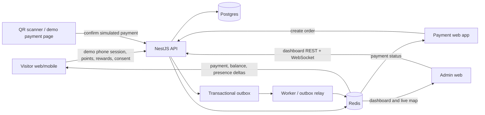
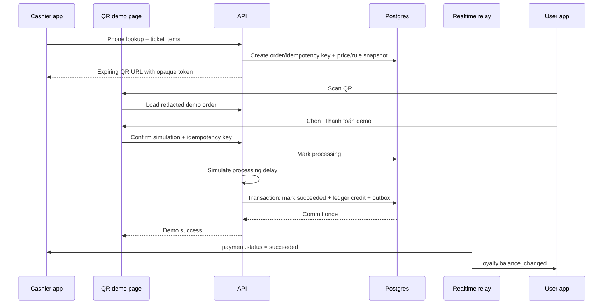
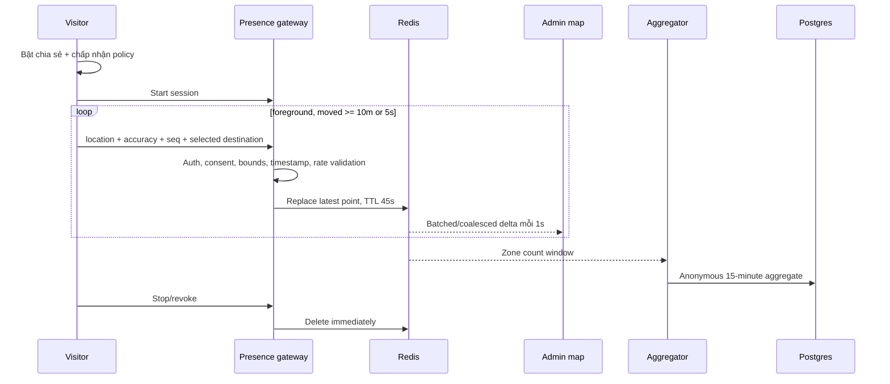

# Kế hoạch triển khai Dashboard vận hành, tài khoản số điện thoại, điểm thưởng, thanh toán QR mô phỏng và bản đồ realtime

- Trạng thái: `IN_PROGRESS` — demo vertical slice đã triển khai; realtime scale-out, load/failure drill và rollout gate còn mở
- Ngày lập: 2026-10-11
- Chế độ: `DEMO_ONLY` — không gửi OTP, không kết nối ngân hàng/cổng thanh toán và không xử lý tiền thật
- Phạm vi kiến trúc: modular monolith hiện tại, một payment web app mô phỏng riêng, Postgres, Redis và worker hiện có
- Tài liệu nền: [PROJECT_PLAN.md](../../PROJECT_PLAN.md), [AGENT_EXECUTION_PLAN.md](../AGENT_EXECUTION_PLAN.md), [FEATURE_REGISTRY.md](../FEATURE_REGISTRY.md), ADR 0001 và ADR 0005
- Theo dõi tiến độ: [OPERATIONS_LOYALTY_PAYMENT_REALTIME_MAP_CHECKLIST.md](OPERATIONS_LOYALTY_PAYMENT_REALTIME_MAP_CHECKLIST.md)

## 1. Mục tiêu và kết quả mong đợi

Kế hoạch này bổ sung bốn nhóm khả năng có liên hệ chặt với nhau:

1. Admin có dashboard doanh thu, người dùng và thời điểm đông/vắng.
2. Khách có tài khoản demo gắn với số điện thoại, không cần OTP, có thể xem điểm, lịch sử và đổi quà.
3. Nhân viên dùng một app thanh toán mô phỏng riêng để nhập số điện thoại, chọn vé và tạo QR. Người dùng quét QR để mở trang demo, chạy các bước `pending -> processing -> succeeded`; server sau đó ghi nhận giao dịch mô phỏng và cộng điểm đúng một lần.
4. Khách có thể chủ động chia sẻ vị trí trong lúc sử dụng bản đồ; admin vận hành thấy các avatar đang hoạt động, vị trí gần nhất và POI đích do chính khách chọn.

Kết quả quan trọng nhất không chỉ là UI. Doanh thu mô phỏng, điểm và trạng thái thanh toán phải có nguồn sự thật, chống xử lý lặp và audit được; vị trí chính xác phải là dữ liệu tạm thời, có consent và tự hết hạn.

Toàn bộ UI thanh toán phải hiển thị nhãn rõ ràng `MÔ PHỎNG — KHÔNG PHẢI THANH TOÁN THẬT`. `DEMO_MODE` phải mặc định tắt ngoài môi trường development/demo; QR không được chứa số điện thoại, user ID, giá trị điểm hoặc dữ liệu nhạy cảm.

## 2. Các quyết định cần duyệt trước khi implementation

Task `N00` phải chốt các điểm sau bằng ADR/product contract. Không bắt đầu schema công khai trước khi xác nhận demo guard và privacy contract.

| Quyết định | Đề xuất mặc định | Lý do |
|---|---|---|
| Chế độ payment | Bộ mô phỏng nội bộ, không có provider/webhook thật | Đúng mục tiêu demo và tránh tạo cảm giác đã thu tiền thật |
| Đơn vị tiền | VND dạng số nguyên (`bigint`), không dùng float | Tránh sai số tiền tệ |
| Định danh khách | Số điện thoại chuẩn E.164, demo login không OTP; email/password cũ vẫn hoạt động | Giảm scope nhưng phải được khóa bởi `DEMO_MODE` |
| Bảo vệ số điện thoại | HMAC để tra cứu + `phone_last4`; API chỉ trả dạng che | Demo không cần khôi phục số đầy đủ từ database và không log/index phone raw |
| QR demo | URL chứa token ngẫu nhiên một lần, lưu hash ở server và có hạn dùng | Không nhúng phone/user/amount trực tiếp vào QR |
| Cách tính điểm | Rule có version; order lưu snapshot rule; chỉ credit khi payment `succeeded` | Không để thay đổi rule làm đổi lịch sử |
| Giao dịch lỗi/thử lại | Simulator hỗ trợ `failed`/`expired`; reset demo tạo order mới | Giữ flow rõ ràng, không cần tích hợp refund tiền thật trong MVP demo |
| Quyền mới | `CASHIER`, `OPERATIONS`; `ADMIN` có toàn quyền | Không dùng tài khoản admin chung cho quầy vé và màn hình vận hành |
| Realtime | NestJS WebSocket Gateway + Socket.IO, Redis adapter khi chạy nhiều instance | Có reconnect, room, ack và scale-out rõ ràng |
| Lưu vị trí | Vị trí chính xác/destination chỉ ở Redis, TTL ngắn; Postgres chỉ lưu thống kê zone đã tổng hợp | Tuân thủ tinh thần ADR 0005 và giảm rủi ro theo dõi lịch sử |
| Nhận diện trên live map | Pseudonym/avatar mặc định; chỉ role được cấp riêng mới thấy thông tin tài khoản đã che | “Biết user nào” không đồng nghĩa công khai số điện thoại hoặc tên |
| Múi giờ báo cáo | `Asia/Ho_Chi_Minh` | Ngày/tuần/tháng phải thống nhất ở API và UI |

ADR 0005 hiện cấm lưu/chia sẻ raw GPS ngoài luồng cho phép. Live operations map là mục đích xử lý mới, vì vậy phải tạo ADR mới mô tả consent, quyền truy cập, TTL, retention và quy trình rút consent.

## 3. Phạm vi MVP và ngoài phạm vi

### 3.1 MVP

- Dashboard:
  - số khách hoạt động hôm nay;
  - số khách có giao dịch hôm nay;
  - doanh thu hôm nay, hôm qua, tuần hiện tại và tháng hiện tại;
  - tổng giá trị giao dịch mô phỏng thành công;
  - khung 15 phút đông nhất/vắng nhất theo số phiên hiện diện đã consent;
  - giao dịch mới và trạng thái realtime.
- Tài khoản khách:
  - nhập số điện thoại để tạo hoặc mở tài khoản demo, không gửi OTP;
  - xem số dư điểm và lịch sử ledger;
  - xem danh mục quà, đổi quà và lịch sử đổi quà.
- Payment simulator app riêng:
  - role `CASHIER`;
  - nhập số điện thoại, xác nhận đúng tài khoản dạng che;
  - chọn loại vé/số lượng;
  - tạo order và QR URL có token một lần, có thời hạn;
  - người dùng quét QR, mở trang mô phỏng và xác nhận “Thanh toán demo”;
  - nhận trạng thái `pending -> processing -> succeeded/failed/expired`;
  - thành công thì sinh ledger điểm và cập nhật màn hình trong vài giây.
- Live map:
  - khách bật/tắt chia sẻ vị trí chủ động;
  - chỉ gửi foreground khi app đang dùng;
  - admin thấy avatar, trạng thái online/last seen và POI đích được khách chọn;
  - clustering, batching và TTL để bản đồ ổn định khi nhiều user.

### 3.2 Ngoài phạm vi MVP

- Không tự suy luận nơi khách “đang đi tới” từ GPS; chỉ hiển thị destination khi khách đã chọn route.
- Không lưu lịch sử đường đi raw, background GPS hoặc dùng vị trí cho quảng cáo.
- Không coi redirect/client callback là bằng chứng thanh toán.
- Không hỗ trợ chuyển điểm giữa các tài khoản.
- Không có marketplace, tier loyalty phức tạp, coupon engine hoặc dynamic pricing trong wave đầu.
- Không bao gồm phát hành/soát vé tại cổng nếu chưa có product contract riêng; order line chỉ ghi loại vé đã bán.
- Không gửi SMS/OTP và không xác minh chủ sở hữu thật của số điện thoại.
- Không tích hợp ngân hàng, ví điện tử, payment gateway, webhook hoặc refund tiền thật.
- Không được bật demo login/payment trong production.

## 4. Những gì tái sử dụng và khoảng trống hiện tại

| Năng lực hiện có | Tái sử dụng | Khoảng trống cần bổ sung |
|---|---|---|
| `AUTH-SESSION`, `AUTH-RBAC` | Access/refresh token, guard, role, Argon2id, audit convention | Demo phone session, identity migration, `CASHIER`/`OPERATIONS`, demo guard/rate limit |
| `EVENT-BATCH` | Consent, schema version, idempotency, cấm raw GPS/PII | Không dùng bảng analytics làm sổ tiền/điểm; cần domain tables và aggregate riêng |
| Postgres/PostGIS | Transaction, lock, index, migration convention | Payment, loyalty, redemption, dashboard aggregate/outbox schema |
| Redis local infra | Presence TTL, pub/sub, Socket.IO adapter, rate limiting | Client/runtime dependency và production topology |
| Worker process | Relay outbox, retry và background aggregation | Payment/loyalty jobs phải tách queue/metric khỏi TTS/search |
| Admin Next.js + MapLibre | Shell/RBAC, live map, dashboard | Routes/components mới và realtime client |
| Visitor web GPS/map | Foreground GPS, route destination, MapLibre | Consent UI, presence session, phone profile/points/rewards |
| `scripts/load-test.mjs` và CI | Cách viết load/fault harness | Kịch bản socket, QR simulation và concurrent redemption |

Không mở microservice mới ở giai đoạn đầu. Payment, loyalty, reporting và presence là các NestJS module độc lập trong modular monolith; chỉ tách service khi metric thực tế cho thấy cần.

## 5. Kiến trúc đích



### 5.1 Nguyên tắc nguồn sự thật

- Postgres là nguồn sự thật cho order, payment, doanh thu, điểm, đổi quà và audit.
- Redis chỉ giữ trạng thái online/vị trí gần nhất có TTL, room/socket routing và cache snapshot ngắn hạn.
- WebSocket là kênh thông báo, không phải nguồn sự thật. Sau reconnect client phải gọi REST lấy snapshot mới.
- `analytics_events` không được dùng để tính doanh thu hoặc số dư điểm.
- Simulator chỉ xác nhận bằng opaque one-time token; transition `processing -> succeeded` và cộng điểm chạy ở server, idempotent trong một transaction.

## 6. Định nghĩa chỉ số dashboard

Phải chốt tên metric ngay từ contract để tránh một số có nhiều cách hiểu.

| Metric | Định nghĩa đề xuất |
|---|---|
| Active visitors today | Số user/session duy nhất đã mở presence session hoặc có event hoạt động hợp lệ trong ngày; hiển thị tách `identified` và `anonymous` |
| Paying users today | Số `user_id` duy nhất có payment chuyển sang `succeeded` trong ngày |
| Online now | Presence session còn TTL và chưa revoke |
| Simulated revenue | Tổng amount của order demo `succeeded`, theo `paid_at`; UI luôn ghi “doanh thu mô phỏng” |
| Today | 00:00 `Asia/Ho_Chi_Minh` đến hiện tại |
| Yesterday | Toàn bộ ngày lịch liền trước |
| This week | Thứ Hai 00:00 đến hiện tại |
| This month | Ngày 1 lúc 00:00 đến hiện tại |
| Peak/quiet interval | Max/min số presence session duy nhất theo bucket 15 phút; bỏ bucket ngoài giờ mở cửa và bucket thiếu dữ liệu |

Dashboard phải trả thêm `generatedAt`, timezone, phạm vi thời gian và trạng thái dữ liệu (`live`, `delayed`, `partial`) để admin không hiểu nhầm.

## 7. Thiết kế dữ liệu đề xuất

Tên migration cụ thể chỉ được cấp lúc implementation vì workspace đang có migration mới chưa commit. Không sửa migration đã chạy.

### 7.1 Identity demo không OTP

- `users`: giữ `id`, status, locale, timestamps; cho phép principal phone-only theo migration tương thích ngược.
- `user_phone_identities`:
  - `user_id` unique FK;
  - `phone_lookup_hash` unique (HMAC chuẩn E.164);
  - `phone_last4`, `created_at`, `updated_at`;
  - không có `verified_at` vì demo không xác minh quyền sở hữu số điện thoại.
- Demo phone session chỉ hoạt động khi `DEMO_PHONE_AUTH_ENABLED=true` và môi trường không phải production.
- Chỉ dùng số demo/synthetic trong shared staging; không log phone raw.
- Email/password flow hiện tại vẫn chạy. Shared DTO chuyển theo hướng additive: `email?`, `phoneMasked?`, `authMethods`.

### 7.2 Vé và payment

- `ticket_products`: code, tên, price VND, active, validity metadata.
- `payment_orders`: user, cashier, mode=`demo`, status, amount, currency, QR expiry, `created_at`, `processing_at`, `paid_at`.
- `payment_order_items`: product ID, quantity, unit price snapshot, subtotal.
- `demo_payment_tokens`: order ID, token hash unique, expiry, consumed time; raw token chỉ xuất hiện trong QR URL.
- `payment_simulation_events`: order, step, idempotency key và timestamp để minh họa tiến trình.
- Index chính: status/time, user/time, token hash unique, paid time và cashier/time.

State machine:

```text
created -> pending -> processing -> succeeded
                  -> failed
                  -> expired
```

Không cho client gửi giá tiền hoặc số điểm. Cashier chỉ gửi `ticketProductId` và `quantity`; server tải sản phẩm active, tính amount và lưu snapshot. Trang scan QR chỉ gửi opaque token và lệnh bắt đầu mô phỏng; server tự chuyển trạng thái và cộng điểm.

### 7.3 Loyalty và đổi quà

- `loyalty_accounts`: `user_id` unique, balance snapshot, version, timestamps.
- `loyalty_ledger_entries`: immutable; user, delta, type, source type/id, rule version, idempotency key, balance after, created time.
- `loyalty_rules`: version, effective range, ticket product, points formula/status.
- `reward_catalog`: code, tên, điểm cần, stock policy, active range.
- `reward_redemptions`: user, reward snapshot, points cost, status, fulfillment code, timestamps.

Ledger là nguồn sự thật. `loyalty_accounts.balance` chỉ là snapshot tối ưu đọc và phải được cập nhật trong cùng transaction với ledger. Unique `(source_type, source_id, entry_type)` chống cộng/trừ điểm lặp.

Redemption dùng transaction + row lock/version check để hai request song song không thể tiêu cùng một số điểm. Không update/delete ledger lịch sử; điều chỉnh thủ công tạo entry `admin_adjustment` có actor, reason và audit log.

### 7.4 Presence và dashboard aggregate

- Redis key `presence:{sessionId}`: user/pseudonym, avatar variant, lat/lng, accuracy, destination POI, sequence, updated time, TTL 45 giây.
- Postgres `presence_sessions`: lifecycle/consent audit, không lưu raw lat/lng trace.
- Postgres `presence_zone_intervals`: zone ID, bucket 15 phút, unique/peak count; không có user ID hoặc tọa độ.
- `reporting_daily_metrics`: optional rollup khi query trực tiếp không còn đạt SLO.
- `domain_outbox`: event ID, type, schema version, aggregate ID, payload tối thiểu, created/published time, retry count.

Zone aggregate chỉ ghi khi đạt ngưỡng tối thiểu được ADR duyệt; bucket có quá ít user phải được suppress để tránh suy ngược hành vi cá nhân.

## 8. API và realtime contract dự kiến

OpenAPI/shared types được cập nhật trước hoặc trong cùng task. Mọi endpoint dùng error envelope hiện có.

### 8.1 Identity và loyalty

```text
POST /v1/demo-auth/phone-session           { phone }
GET  /v1/me                                profile + phoneMasked
GET  /v1/me/loyalty                        balance + recent ledger
GET  /v1/rewards                           active rewards
POST /v1/me/reward-redemptions             { rewardId, idempotencyKey }
GET  /v1/me/reward-redemptions

GET  /v1/admin/users?phone=&status=
GET  /v1/admin/users/:id/loyalty
POST /v1/admin/users/:id/loyalty-adjustments
```

Endpoint demo tạo hoặc mở tài khoản theo phone hash rồi phát hành session hiện có. Endpoint phải hard-fail ngoài demo mode. Admin/cashier search chuẩn hóa phone ở server, phản hồi tối thiểu và có rate limit/audit.

### 8.2 Payment app

```text
GET  /v1/cashier/ticket-products
POST /v1/cashier/customer-lookups          { phone }
POST /v1/cashier/payment-orders            { customerToken, items[], idempotencyKey }
GET  /v1/cashier/payment-orders/:id
POST /v1/cashier/payment-orders/:id/cancel
GET  /v1/demo-payments/:token              public demo order summary, không có PII
POST /v1/demo-payments/:token/confirm      { idempotencyKey }
```

`customerToken` là token lookup ngắn hạn, không gửi user ID có thể đoán hoặc echo phone qua nhiều request. QR trỏ tới `/demo-pay/:token`; token đủ dài, lưu hash, một lần và hết hạn.

### 8.3 Dashboard và live map

```text
GET  /v1/admin/dashboard/summary?from=&to=&timezone=
GET  /v1/admin/dashboard/traffic?from=&to=&bucket=15m
GET  /v1/admin/dashboard/payments?cursor=
GET  /v1/admin/presence/snapshot?bounds=
POST /v1/me/presence-sessions              consentVersion + shareIdentity mode
DELETE /v1/me/presence-sessions/:id
```

### 8.4 WebSocket namespaces/events

| Namespace/room | Client -> server | Server -> client |
|---|---|---|
| `/payments`, `payment:{orderId}` | subscribe with access token | `payment.status.v1`, `loyalty.balance_changed.v1` |
| `/presence`, own session | `presence.update.v1`, heartbeat, stop | ack with accepted sequence/TTL |
| `/admin`, operations room | subscribe bounds/zones | `dashboard.delta.v1`, `presence.snapshot.v1`, `presence.delta.v1` |

Mỗi event có `eventId`, `schemaVersion`, `sequence`, `occurredAt`. Server kiểm tra quyền room; client bỏ event sequence cũ. Sau reconnect, client gọi REST snapshot rồi mới áp delta.

## 9. Luồng nghiệp vụ trọng yếu

### 9.1 Thanh toán và cộng điểm đúng một lần



Confirm bị bấm lặp, retry sau timeout hoặc process restart phải trả kết quả idempotent và không tạo thêm ledger. Nếu realtime bị mất, polling `GET order`/`GET loyalty` vẫn cho kết quả đúng.

### 9.2 Presence realtime an toàn và ổn định



Avatar variant được sinh ổn định từ presence session, không từ giới tính/tuổi hoặc thuộc tính nhạy cảm. Admin chỉ thấy `đang tới POI X` khi destination do khách chủ động chọn.

## 10. Chiến lược ổn định khi có nhiều user

### 10.1 Server

- Client chỉ gửi khi app foreground, tối đa mỗi 5 giây và khi dịch chuyển tối thiểu khoảng 10 m; GPS accuracy quá kém không phát tán như vị trí chắc chắn.
- Gateway xác thực timestamp, sequence, park bounds, accuracy, payload size và rate limit.
- Redis giữ latest state thay vì queue mọi điểm; update mới ghi đè update cũ.
- Realtime relay coalesce thay đổi và phát batch mỗi 1 giây cho admin.
- Socket room chia theo park/zone; không broadcast toàn hệ thống.
- Production nhiều API instance dùng Redis adapter; readiness phải fail khi realtime dependency bắt buộc bị lỗi.
- Backpressure: bỏ intermediate location delta, không bao giờ bỏ payment state hoặc balance event; client luôn có REST recovery.

### 10.2 Admin MapLibre

- Dùng một GeoJSON/vector source + symbol layer, không render một React marker cho mỗi user.
- Cluster ở zoom thấp; chỉ render avatar chi tiết trong viewport/zoom phù hợp.
- Cập nhật source theo batch, không `setState` cho từng socket event.
- Avatar sprite giới hạn 8–16 biến thể, tải một lần.
- Khi vượt ngưỡng marker, ưu tiên cluster/zone count và thông báo chế độ density.
- Remove marker khi TTL hết; `last seen` chỉ giữ ngắn hạn trên UI.

### 10.3 Capacity gate đề xuất

Hai mức phải được đo, không chỉ ước lượng:

| Gate | Mục tiêu |
|---|---|
| MVP/staging | 1.000 socket kết nối, 500 user gửi vị trí mỗi 5 giây (~100 update/s), 10 admin map |
| Production candidate | 5.000 socket, 2.000 user chia sẻ (~400 update/s), 20 admin map; p95 WebSocket delta < 2 giây |

Giới hạn production cuối cùng phải lấy từ sức chứa/ngày cao điểm thực tế. Nếu chưa có số, chỉ cam kết gate staging và không ghi “production ready”.

## 11. Kế hoạch triển khai theo wave

```text
N00 Decisions/ADR
  -> N01 Contracts + schema foundation
     -> N02 Phone identity
     -> N03 Loyalty ledger
     -> N06 Realtime/outbox foundation
N02 + N03 -> N04 Payment simulator backend
N04 + N06 -> N05 Payment app
N02 + N06 -> N07 Presence + admin live map
N04 + N07 -> N08 Operations dashboard
N05 + N07 + N08 -> N09 Hardening/load/privacy
N09 -> N10 Staged rollout and acceptance
```

### Wave A — Product, privacy và contract

#### Task N00 — Product rules, demo guard và privacy ADR

```text
Task ID: N00
Goal: Chốt định nghĩa metric, demo phone identity không OTP, rule điểm, reward fulfillment, payment simulation và live-location consent.
In scope: ADR, demo-only guard, abuse cases, retention/deletion, role/permission matrix, QR simulation rules, dashboard glossary.
Out of scope: code, migration và UI.
Dependencies completed: T10/T11, T51; đọc ADR 0001 và 0005.
Files/modules allowed: docs/adr/**, docs/product/**, docs/plans/**.
Contracts consumed: auth/RBAC, analytics privacy và yêu cầu demo.
Contracts produced: accepted ADR + product rules + metric glossary + capacity target.
Required reading: AGENTS.md; docs/STATUS.md; docs/FEATURE_REGISTRY.md; ADR 0001/0005; plan này §§2–10.
Acceptance checks: mọi quyết định ở §2 có owner; QR demo flow và production hard-disable được chốt; retention và consent được duyệt.
Verification commands: markdown/links check; coordinator sign-off.
```

#### Task N01 — Shared contracts, migrations và module skeleton

```text
Task ID: N01
Goal: Tạo contract additive và schema nền cho identity, payment, loyalty, reward, presence session, outbox và reporting.
In scope: OpenAPI/shared types trước; forward migration mới + rollback/forward-fix; repository interfaces; module skeleton; feature flags off.
Out of scope: UI, WebSocket traffic và mọi tích hợp OTP/payment provider thật.
Dependencies completed: N00.
Files/modules allowed: packages/shared-types/**, packages/api-client/**, OpenAPI, infra/migrations/**, apps/api/src/{identity,payments,loyalty,presence,reporting,outbox}/**.
Contracts consumed: N00 ADR/product rules, current error envelope/auth principal.
Contracts produced: schema + DTO/event v1 + generated client + registry entries planned/in_progress.
Required reading: AGENTS.md; N00 outputs; current auth/analytics repository and migrations 003/008.
Acceptance checks: existing email auth remains compatible; money is integer VND; FKs/index/check/unique idempotency exist; down/forward-fix path documented.
Verification commands: migration up/down/up on clean Postgres; lint; typecheck; contract tests.
```

### Wave B — Identity, loyalty và realtime foundation

#### Task N02 — Demo phone account không OTP

```text
Task ID: N02
Goal: User có thể tạo/mở tài khoản demo bằng số điện thoại, không OTP, mà không làm hỏng email login hiện tại.
In scope: E.164 normalization; HMAC lookup + last4; demo phone session; production hard-disable; rate limit; masked profile; admin lookup audited.
Out of scope: xác minh quyền sở hữu số, OTP/SMS, social login, marketing và contact upload.
Dependencies completed: N01 và demo identity decision từ N00.
Files/modules allowed: apps/api/src/auth/** hoặc identity module được N01 chốt; visitor auth/profile UI; shared contract files do shared owner điều phối.
Contracts consumed: current access/refresh token, RBAC, identity DTO v1.
Contracts produced: demo phone-session API, masked identity DTO, auth events without raw phone.
Required reading: auth tests/service/repository; config conventions; N00 demo/privacy ADR.
Acceptance checks: same normalized phone mở đúng account; demo endpoint hard-fail ngoài demo; rate tests; logs/errors không có phone raw; email login regression pass.
Verification commands: focused unit/HTTP/DB tests; auth real-DB smoke; lint/typecheck/build visitor.
```

#### Task N03 — Loyalty ledger và reward redemption

```text
Task ID: N03
Goal: Có sổ điểm immutable, balance nhất quán và đổi quà chống double-spend.
In scope: account, ledger, versioned earn rule, reward catalog, redemption transaction và admin adjustment audit.
Out of scope: tier, transfer point, coupon/promotion engine.
Dependencies completed: N01; user principal contract ổn định.
Files/modules allowed: apps/api/src/loyalty/**, loyalty migrations/tests; visitor/admin loyalty UI theo ownership.
Contracts consumed: user ID, audit convention, error envelope.
Contracts produced: `/me/loyalty`, rewards/redemptions, admin adjustment APIs, `loyalty.balance_changed.v1` outbox event.
Required reading: N00 point/reward rules; existing audit/RBAC implementation.
Acceptance checks: duplicate source không credit hai lần; two concurrent redemption chỉ một thành công; balance bằng tổng ledger; adjustment có actor/reason.
Verification commands: unit + Postgres transaction/concurrency tests; contract tests; migration smoke.
```

#### Task N06 — Transactional outbox và authenticated WebSocket foundation

```text
Task ID: N06
Goal: Có kênh realtime recoverable cho payment/loyalty/presence mà không biến socket thành source of truth.
In scope: domain outbox, relay retry/dead-letter, Nest Gateway, token auth, room authorization, schemaVersion/sequence, reconnect REST strategy, Redis adapter config.
Out of scope: feature UI và mọi tích hợp payment provider thật.
Dependencies completed: N01; Redis runtime available.
Files/modules allowed: apps/api/src/{outbox,realtime}/**, apps/worker/** assigned queue modules, packages/config/**, infra/**, shared event contracts.
Contracts consumed: access token/RBAC, config, pg pool, error/log conventions.
Contracts produced: versioned realtime envelope, room authorization policy, outbox repository/relay.
Required reading: FND-PG-POOL, worker queue patterns, T52 requirements.
Acceptance checks: event survives process restart; duplicate publish tolerated; unauthorized room denied; reconnect snapshot works; Redis down degrades without corrupting DB state.
Verification commands: unit/integration tests; API+worker+Redis smoke; fault drill; typecheck.
```

N02, N03 và N06 có thể chạy song song sau N01 nếu shared files chỉ có một owner.

### Wave C — Payment vertical slice

#### Task N04 — Payment order và QR simulator

```text
Task ID: N04
Goal: Từ order vé đến trang scan QR mô phỏng thành công, payment demo và điểm được commit đúng một lần.
In scope: product catalog; server-side pricing; order state machine; opaque one-time QR token; demo processing delay/success/failure; payment+loyalty+outbox transaction.
Out of scope: cashier UI, OTP, ngân hàng/ví/cổng thanh toán, webhook, tiền thật, refund và chargeback.
Dependencies completed: N02, N03; outbox interface từ N06.
Files/modules allowed: apps/api/src/payments/**, demo config, payment migrations/tests.
Contracts consumed: demo phone customer token, loyalty credit API/transaction boundary, realtime event envelope.
Contracts produced: cashier order API, public redacted demo-payment API, payment states/events và audit output.
Required reading: N00 demo ADR; loyalty ledger invariants; API error conventions.
Acceptance checks: tampered amount rejected; QR không lộ PII; expired/consumed token rejected; duplicate confirm idempotent; timeout/restart retry safe; success credit once; day-boundary timestamp correct; endpoint hard-fail ngoài demo.
Verification commands: HTTP/DB tests; QR confirm replay suite; simulated success/failure/expiry smoke; migration up/down/up.
```

#### Task N05 — App thanh toán riêng

```text
Task ID: N05
Goal: Cashier hoàn tất phone -> ticket -> QR -> confirmed flow bằng app riêng.
In scope: apps/payment-web; CASHIER login/authorization; phone lookup; ticket selection; order summary; QR countdown; public `/demo-pay/:token` page; simulated processing UI; WebSocket status + polling fallback; result; retry/cancel UX.
Out of scope: admin dashboard, user reward UI, ticket gate scanning.
Dependencies completed: N04 và N06.
Files/modules allowed: apps/payment-web/**; api-client consumer only; root workspace scripts with coordinator ownership.
Contracts consumed: cashier product/order/customer lookup API, `payment.status.v1`.
Contracts produced: payment app routes and browser E2E flow.
Required reading: admin/visitor session patterns; QR/token expiry contract; accessibility rules.
Acceptance checks: mọi màn hình có nhãn mô phỏng; client cannot choose price/points; masked phone; expired QR handled; confirm lặp không cộng điểm lặp; reconnect recovers state; double-click creates one order; non-CASHIER denied.
Verification commands: lint/typecheck/test/build; real-browser demo E2E; offline/reconnect smoke.
```

### Wave D — Presence và operations dashboard

#### Task N07 — Consent-based presence và admin live map

```text
Task ID: N07
Goal: Admin thấy user đã opt-in trên map ổn định, không lưu raw location history.
In scope: consent UI; presence session; foreground throttled updates; Redis TTL; pseudonym/avatar; destination from active route; admin snapshot/delta; MapLibre symbol/cluster layers.
Out of scope: background tracking, inferred destination, historical person trace, surveillance export.
Dependencies completed: N02, N06 và privacy ADR từ N00.
Files/modules allowed: apps/api/src/presence/**, visitor location/presence adapter, apps/admin-web live-map files, Redis/config/tests.
Contracts consumed: foreground GPS state, route destination, authenticated realtime envelope, MapLibre conventions.
Contracts produced: presence REST/socket v1, live map screen, anonymized zone aggregate feed.
Required reading: ADR 0005 + replacement/amendment; GPS-SESSION; visitor auto-guide; map marker architecture.
Acceptance checks: opt-out deletes latest point immediately; TTL removes disconnected user; old seq rejected; out-of-bounds/rate abuse rejected; no lat/lng in DB/log; 1.000-marker browser smoke remains responsive.
Verification commands: unit/socket/contract tests; privacy log scan; MapLibre browser smoke; staging load gate.
```

#### Task N08 — Admin operations dashboard

```text
Task ID: N08
Goal: Admin xem metric tiền/user/traffic nhất quán theo định nghĩa §6, có realtime delta và historical query.
In scope: reporting queries/rollups; summary cards; today/yesterday/week/month; simulated revenue; 15-minute peak/quiet chart; recent demo-payment feed; data freshness/status.
Out of scope: BI ad-hoc builder, raw GPS heatmap, accounting ledger export chuẩn tài chính.
Dependencies completed: N04; zone aggregate từ N07; metrics glossary N00.
Files/modules allowed: apps/api/src/reporting/**, apps/admin-web dashboard files, reporting migration/tests.
Contracts consumed: demo payment success timestamps, presence zone aggregate, timezone rules.
Contracts produced: dashboard REST DTOs, `dashboard.delta.v1`, admin dashboard pages.
Required reading: admin shell; analytics privacy; payment and presence schema.
Acceptance checks: boundary 00:00/month/week correct; totals reconcile SQL source; empty/partial data rõ; OPERATIONS/ADMIN allowed, CASHIER/visitor denied; query p95 đạt SLO.
Verification commands: unit/DB fixtures; timezone boundary tests; API contract; admin lint/typecheck/test/build/browser smoke.
```

N07 có thể bắt đầu song song với N04/N05 sau N02+N06. N08 chỉ bắt đầu khi nguồn payment và zone aggregate ổn định.

### Wave E — Hardening, tải và rollout

#### Task N09 — Security, privacy, load và failure drills

```text
Task ID: N09
Goal: Chứng minh hệ thống an toàn và ổn định dưới lỗi/lưu lượng mục tiêu.
In scope: demo guard/token abuse, RBAC negatives, PII/GPS log scan, DB/Redis restart, socket reconnect/backpressure, duplicate confirm, concurrent redemption, balance consistency, backup/restore, metrics/alerts và capacity gates.
Out of scope: thêm feature mới.
Dependencies completed: N05, N07, N08.
Files/modules allowed: infra/**, CI, test/load harness, runbooks; business fixes chỉ qua owner module.
Contracts consumed: toàn bộ SLO/invariants ở plan này.
Contracts produced: test report, capacity result, release blockers, rollback runbook.
Required reading: T52, T60, existing load/storage/fault scripts.
Acceptance checks: không double-credit/double-spend; no PII/raw GPS logs; simulator hard-fail ngoài demo; Redis outage degrades safely; staging capacity gate pass; alerts actionable.
Verification commands: root quality gate; API/payment/browser E2E; load tests; fault injection; backup/restore; dependency scan.
```

#### Task N10 — Staged rollout và acceptance

```text
Task ID: N10
Goal: Phát hành demo theo feature flag, kiểm tra pilot và có reset/rollback rõ ràng.
In scope: seed ticket/reward catalog; synthetic users; internal demo pilot; compare dashboard với order/ledger; consent review; demo readiness verdict.
Out of scope: production phone authentication, payment thật và bật live tracking ngoài môi trường demo được duyệt.
Dependencies completed: N09 PASS và blockers được owner duyệt.
Files/modules allowed: deployment config, runbooks, seed data được review; không sửa schema/contract phút cuối.
Contracts consumed: release checklist, demo-mode policy và privacy/retention approvals.
Contracts produced: acceptance report, reset/rollback evidence, GO/NO-GO cho demo.
Required reading: T60–T62; N09 report; ADR decisions.
Acceptance checks: end-to-end demo khớp 100% order/ledger; opt-out verified; flags rollback without data loss; admin/cashier biết đây là mô phỏng; dashboards match source records.
Verification commands: demo E2E; order/ledger consistency check; feature-flag rollback drill; root gate; demo checklist.
```

## 12. UI đề xuất

### 12.1 Admin web

- `/dashboard`: metric cards, comparisons, revenue trend, hourly traffic, peak/quiet, recent transactions, data freshness.
- `/users`: phone-masked search, status, balance, ledger, redemptions, audited adjustment.
- `/rewards`: reward catalog, cost, availability, redemption fulfillment.
- `/live-map`: live/density toggle, filters by zone/status/destination, cluster count, connection health.

Không đặt live map dày đặc vào dashboard chính; tách route để giảm tải và tránh mở dữ liệu vị trí ngoài nhu cầu vận hành.

### 12.2 Visitor web/mobile

- Nhập số điện thoại để mở/tạo demo session, luôn có banner không xác minh OTP.
- Profile card: phone masked, point balance, recent earning.
- Visitor web subscribe room của chính user; khi payment demo thành công, hiển thị toast/modal “Thanh toán mô phỏng thành công”, số điểm vừa cộng và refresh balance từ REST.
- Rewards catalog + confirmation + redemption code/status.
- “Chia sẻ vị trí với điều hành” là toggle riêng, giải thích ai xem, mục đích, TTL và nút dừng ngay.

### 12.3 Payment web

- Màn hình 1: nhập phone, xác nhận tài khoản masked hoặc tạo account pending verification theo policy.
- Màn hình 2: chọn ticket/quantity, server-rendered price và points preview.
- Màn hình 3: QR + countdown + trạng thái đang chờ.
- Trang scan QR: nhãn demo, tóm tắt đã redaction, nút “Thanh toán demo”, animation `processing` rồi success/failure.
- Màn hình cashier cuối: success/failed/expired; hiển thị order ID, giá trị mô phỏng, điểm đã cộng và nút giao dịch mới.

## 13. Feature flags và rollout

Các flag mặc định `off`:

```text
DEMO_MODE
DEMO_PHONE_AUTH_ENABLED
LOYALTY_ENABLED
DEMO_PAYMENTS_ENABLED
PRESENCE_SHARING_ENABLED
ADMIN_LIVE_MAP_ENABLED
OPERATIONS_DASHBOARD_ENABLED
```

Thứ tự bật: synthetic accounts -> demo payment simulator -> staff demo -> loyalty read-only -> loyalty earn -> redemption -> presence opt-in -> live map -> dashboard demo. Mỗi bước có rollback độc lập; tắt realtime không được làm mất payment/point demo đã commit.

## 14. Test matrix và tiêu chí release

### 14.1 Bắt buộc

- Auth: demo guard, phone normalization, same-phone session, enumeration/rate limit và production hard-disable.
- Payment: price tampering, token guessing/replay, duplicate confirm, QR expiry, process restart và simulated failure.
- Loyalty: credit exactly once, concurrent redemption, balance consistency và admin adjustment audit.
- Dashboard: timezone/date boundary, simulated revenue, unique user semantics, delayed completion và incomplete bucket.
- Presence: consent/start/stop, TTL, weak GPS, sequence replay, rate limit, Redis restart, socket reconnect.
- Authorization: negative test cho visitor, CASHIER, OPERATIONS, ADMIN ở từng endpoint/room.
- Privacy: không phone raw, QR token, access token hoặc raw GPS trong log, error, analytics payload hoặc persisted trace.

### 14.2 SLO đề xuất

- Demo confirm ACK p95 < 500 ms; trạng thái `succeeded` và điểm đến app p95 < 5 giây sau simulated delay đã cấu hình.
- Loyalty balance read p95 < 300 ms.
- Dashboard summary p95 < 1 giây ở dữ liệu staging đại diện.
- Presence delta p95 < 2 giây ở capacity gate.
- Không mất hoặc cộng trùng điểm trong retry/restart drill.
- Admin map không freeze/crash ở staging gate; frame rate mục tiêu >= 30 FPS trên máy test chuẩn khi viewport có 1.000 feature trước clustering.

## 15. Rủi ro và biện pháp

| Rủi ro | Biện pháp |
|---|---|
| Người dùng hiểu nhầm là payment thật | Banner demo ở mọi màn hình, không dùng thương hiệu provider thật, không yêu cầu thông tin thẻ/ngân hàng |
| QR token bị đoán/lặp | Token ngẫu nhiên đủ dài, lưu hash, TTL, single-use và idempotent confirm transaction |
| Điểm lệch balance | Immutable ledger, balance snapshot trong cùng transaction và consistency check |
| Người khác nhập số điện thoại để mở account | Chỉ dùng synthetic/demo numbers, banner “không xác minh OTP”, rate limit và hard-disable ngoài demo |
| Lộ phone/vị trí | HMAC + last4, masking, least privilege, no raw logs, Redis TTL, consent, audit |
| Bản đồ giật khi đông | Latest-state overwrite, batched deltas, MapLibre layer/cluster, viewport subscription, load gate |
| Redis/WebSocket lỗi | DB source of truth, polling/snapshot fallback, reconnect, no payment data only in Redis |
| Dashboard sai vì định nghĩa mơ hồ | Metric glossary, timezone boundary tests, đối chiếu trực tiếp order/ledger nguồn |
| Scope quá lớn | Ship theo vertical slice và flags; payment/ledger trước, dashboard/live map sau |

## 16. Definition of Done toàn chương trình

Chỉ được đánh dấu hoàn thành khi:

- demo QR flow và pilot khớp 100% order/ledger, confirm lặp không cộng điểm hai lần;
- ledger/reward transaction và balance consistency tests pass;
- dashboard metric khớp source records và có định nghĩa/timezone hiển thị rõ;
- user chủ động bật/tắt presence, raw GPS không nằm trong Postgres/log/analytics;
- live map đạt capacity gate đã duyệt, có reconnect/backpressure/Redis failure evidence;
- RBAC/room authorization negative tests pass;
- OpenAPI/shared client/feature registry/status/runbook đồng bộ;
- backup/restore, key rotation, rollback flags và support procedure được kiểm chứng;
- demo phone/payment hard-fail ngoài môi trường được phép; privacy owner duyệt retention và live-location consent.
